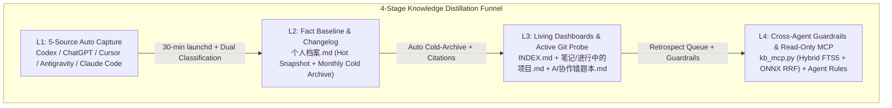

# agent-memory-kb

[中文文档 (README.zh-CN.md)](README.zh-CN.md)

**A local-first, Git-backed, AI-native Personal Knowledge Base & Read-Only MCP Server for multi-agent developers** (Codex, Claude Code, Cursor, Antigravity, and ChatGPT).

Zero cloud memory API fees. 100% local Markdown + SQLite FTS5 + offline INT8 ONNX semantic vectors + automated AI mistake-book evolution + industrial-grade DLP & encrypted disaster recovery.

---

## Why `agent-memory-kb`?

Developers juggling multiple AI coding agents hit the same four walls:
1. **Fragmented memory**: Conversations and decisions are trapped inside Codex, Cursor, Claude Code, Antigravity, and ChatGPT silos.
2. **Context rot & bloat**: Dumping giant markdown notes into prompts wastes tokens and decays over time.
3. **Repeated AI mistakes**: You correct an agent 3 times today, and tomorrow a new session makes the exact same mistake.
4. **Privacy & backup risk**: Cloud memory services require sending private code/life notes to third-party APIs; DIY repos risk leaking tokens or losing history.

`agent-memory-kb` solves all four with a **3-Tier Isolation + 4-Stage Distillation Funnel** architecture:



---

## Core Capabilities

| Layer | Capabilities |
| --- | --- |
| **5-Source Automated Capture** | Incremental read-only exporters for **Codex**, **Cursor**, **Antigravity**, **Claude Code**, and **ChatGPT** (`scripts/export_*.py`) into clean, traceable Markdown. |
| **Offline Hybrid Search** | SQLite FTS5 (`contentless_delete=1` + CJK unigram & natural-language rescue) fused with local offline **INT8 ONNX** multilingual embeddings (`kb_embed.py`) via **RRF** (`kb_search.py`). Zero API cost. |
| **Native Read-Only MCP Server** | `scripts/kb_mcp.py` exposes 5 tools (`kb_overview`, `kb_search_query`, `kb_project_context`, `kb_mistakes_and_guardrails`, `kb_read_note`) with strict root path-traversal protection for Codex, Cursor, Claude Code, and Antigravity. |
| **AI Mistake-Book Closed Loop** | `scripts/kb_retrospect.py` automatically detects high-friction multi-correction conversations, maintains a pending review queue, and injects Top guardrails into new agent sessions. |
| **Industrial DLP & Health Gate** | `scripts/kb_filters.py` + `scripts/kb_doctor.py` bound to `.git/hooks/pre-commit`: blocks JWT, Bearer, Cookie, DB DSN passwords, `.env` keys, ID numbers, contextual high-entropy secrets, broken links, missing citations, budget overflows, and stale project notes. |
| **4-Way Disaster Recovery** | Local Git + atomic `git bundle` + macOS Keychain **AES-256 encrypted iCloud bundle** (with decrypt round-trip check & orphan temp cleanup) + private Git remote (with anti-public-URL safety gate) + isolated clone restore drill (`kb_restore_verify.py`). |
| **Zero-Cost E2EE Mobile Sync** | Ready-to-use **Obsidian + Remotely Save (OneDrive App Folder + RClone Crypt)** workflow & ignore patterns (`templates/跨设备配置.md`). |

---

## 5-Minute Quickstart

### 1. Clone & Initialize Your Local Knowledge Base

```bash
git clone https://github.com/JaydenWuGang123/agent-memory-kb.git
cd agent-memory-kb

# Bootstrap a fresh local KB repo (defaults to ~/personal-kb)
python3 init_kb.py --root ~/personal-kb
```

### 2. Run Your First Sync & Health Check (Zero External Dependencies)

Core indexing, FTS5 search, DLP checks, Git snapshots, and backup verification only require **Python 3.9+ stdlib**:

```bash
python3 ~/personal-kb/_同步/build_kb_index.py --output-root ~/personal-kb --skip-icloud
python3 ~/personal-kb/_同步/kb_doctor.py --root ~/personal-kb
python3 ~/personal-kb/_同步/kb_search.py --root ~/personal-kb -q "your query" --mode fts
```

### 3. (Optional) Enable Read-Only MCP Server & Local ONNX Semantic Vectors

```bash
pip install -r requirements.txt
```

Register `~/personal-kb/_同步/kb_mcp.py` in Codex / Cursor / Claude Code / Antigravity using [`examples/mcp_config.example.json`](examples/mcp_config.example.json), and drop [`examples/agent-rules.md`](examples/agent-rules.md) into your global agent instructions (`AGENTS.md` / `CLAUDE.md` / `GEMINI.md`).

### 4. (Optional) Enable 30-Minute Background Sync & Encrypted iCloud Mirror (macOS)

1. Copy [`examples/personal-kb-sync.sh.example`](examples/personal-kb-sync.sh.example) to `~/.local/bin/personal-kb-sync.sh` and `chmod +x`.
2. Store an encryption passphrase in macOS Keychain (never stored in files):
   ```bash
   security add-generic-password -U -a "$USER" -s "agent-memory-kb.icloud-bundle" -w
   ```
3. Load [`examples/launchd.personal-kb-sync.plist.example`](examples/launchd.personal-kb-sync.plist.example) into `~/Library/LaunchAgents/` (grant `/bin/zsh` Full Disk Access if backing up to iCloud Drive in background).

---

## Running Tests

```bash
python3 -m unittest discover -s scripts -p 'test_*.py' -v
```

---

## License

[MIT](LICENSE)
