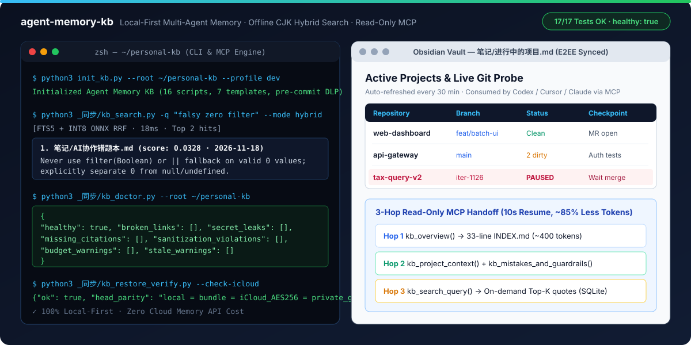
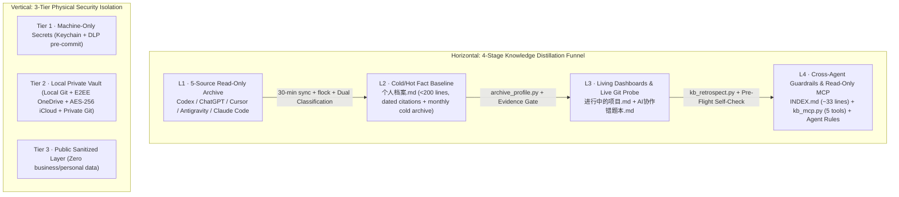

# agent-memory-kb

[](https://github.com/JaydenWuGang123/agent-memory-kb/actions/workflows/ci.yml)
[](LICENSE)
[](https://www.python.org/)
[](#why-agent-memory-kb)

[简体中文首页 (README.zh-CN.md)](README.zh-CN.md) · [Architecture](docs/architecture.md) · [Full Reference](docs/reference.md) · [Team & FAQ](docs/team-and-faq.md)

**A local-first, Git-backed, AI-native Personal Knowledge Base & Read-Only MCP Server for multi-agent developers** — connecting **Codex, Claude Code, Cursor, Antigravity, and ChatGPT** to one structured, privacy-safe, self-evolving brain on your own machine.

> **Core Philosophy**: *In the AI coding era, the first reader of your knowledge base is your Agent — not you.*
> Zero cloud memory API fees. 100% local Markdown + SQLite FTS5 + offline INT8 ONNX semantic search + automated AI mistake-book evolution + industrial DLP & encrypted 4-way disaster recovery.



---

## Why `agent-memory-kb`?

| Dimension | Traditional Notes / Ad-Hoc Prompts | `agent-memory-kb` (Agent-First) |
| --- | --- | --- |
| **Capture** | Manual copy-paste; breaks coding flow, abandoned in 2 weeks | Background sync every 30 min across 5 AI tools (read-only, zero friction) |
| **Cross-Agent Handoff** | 5–15 min re-explaining branch, blockers, and decisions | **~10 seconds**: Agent reads 30-line `INDEX.md` → live Git-probed project board |
| **Token Overhead** | ~12k–25k tokens/session pasting history or giant rule dumps | **~3k tokens** via 3-Hop Progressive Disclosure + local SQLite Top-K retrieval |
| **Repeated Mistakes** | Same bugs keep recurring across sessions | Auto-detects multi-correction sessions → deduplicated `[复发 xN]` guardrails |
| **Security & Backup** | Cloud SaaS lock-in or unguarded local folders | 100% local Markdown + Keychain AES-256 + DLP `pre-commit` + 4-way restore drill |

---

## Who Is This For?

Whether you write code or simply use **Codex / Claude Code / Antigravity / ChatGPT** for daily work, `agent-memory-kb` gives your AI one persistent local brain:

| Role | What You Get Out of the Box |
| --- | --- |
| **Developers (Frontend / Backend / Indie)** | Multi-repo live Git probe, 10-second cross-agent handoff, coding mistake-book guardrails (`--profile dev`) |
| **Product Managers & Operations** | Auto-archive every PRD discussion & research thread, keep confirmed decisions separated from guesses (`--profile general`) |
| **Creators, Writers & Solo Founders** | Capture ideas & script iterations automatically, teach Codex your tone/style and avoid repeating edits (`--profile general`) |
| **Lifelong Learners & Investors** | Track long-term reading, study plans, and personal rules across months; search exact past quotes in milliseconds (`--profile general`) |

---

## 5-Minute Quickstart

### Option A: Zero-Command Setup (Recommended for Codex / Claude / Antigravity Users)

Don't want to run terminal commands or edit JSON by hand? **Paste this single prompt directly into Codex, Claude Code, or Antigravity**:

```text
Please clone https://github.com/JaydenWuGang123/agent-memory-kb and initialize it into ~/personal-kb (use --profile general if I am not a software developer, otherwise --profile dev). Complete the first sync, run kb_doctor.py, wire up the read-only MCP server, and add the global agent rules. Explain each step in plain language and ask me before any optional backup setup.
```

### Option B: Manual Setup (Pure Python 3.9+ Stdlib)

```bash
git clone https://github.com/JaydenWuGang123/agent-memory-kb.git
cd agent-memory-kb

# For developers (default, includes Git repo probe):
python3 init_kb.py --root ~/personal-kb --profile dev

# For non-developers / PMs / creators (goals & expression-preference templates):
python3 init_kb.py --root ~/personal-kb --profile general
```

### 2. Run Your First Sync, Health Check & Search

```bash
python3 ~/personal-kb/_同步/build_kb_index.py --output-root ~/personal-kb --skip-icloud
python3 ~/personal-kb/_同步/kb_doctor.py --root ~/personal-kb
python3 ~/personal-kb/_同步/kb_search.py --root ~/personal-kb -q "your query" --mode fts
```

### 3. Connect Read-Only MCP & Offline Semantic Search (Optional)

```bash
python -m pip install -r requirements.txt
```

For semantic search, set `AGENT_MEMORY_KB_MODEL_DIR` to the directory containing the matching `model_int8.onnx` and `tokenizer.json` for `paraphrase-multilingual-MiniLM-L12-v2`. Use the same virtual environment for installation and search. After building the text index, run `python ~/personal-kb/_同步/kb_embed.py --root ~/personal-kb --sync` and check for `status: ok`. Without the model, hybrid search uses full-text results.

Register `~/personal-kb/_同步/kb_mcp.py` in Codex / Cursor / Claude Code / Antigravity using [`examples/mcp_config.example.json`](examples/mcp_config.example.json), and add [`examples/agent-rules.md`](examples/agent-rules.md) to your global agent instructions (`AGENTS.md` / `CLAUDE.md` / `GEMINI.md`).

For Claude Code on macOS or Linux, run this from the project that should have access. Use the Python interpreter with the MCP dependency installed, then check the connection with `/mcp` and ask Claude to call `kb_overview`.

```sh
claude mcp add --scope local --transport stdio personal-kb -- python3 "$HOME/personal-kb/_同步/kb_mcp.py"
```


### 4. Background Sync (macOS / Linux / Windows) & E2EE Mobile Sync (Optional)

- **macOS (`launchd` + Keychain AES-256 iCloud mirror)**: [`examples/personal-kb-sync.sh.example`](examples/personal-kb-sync.sh.example) & [`examples/launchd.personal-kb-sync.plist.example`](examples/launchd.personal-kb-sync.plist.example).
- **Linux (`systemd` user timer)**: [`examples/linux-systemd/agent-memory-kb.service`](examples/linux-systemd/agent-memory-kb.service) & [`examples/linux-systemd/agent-memory-kb.timer`](examples/linux-systemd/agent-memory-kb.timer).
- **Windows (PowerShell + Task Scheduler)**: [`examples/windows-sync.ps1`](examples/windows-sync.ps1).
- **Zero-cost E2EE Mobile Sync**: open `~/personal-kb` in Obsidian and follow [`templates/跨设备配置.md`](templates/跨设备配置.md) (Remotely Save + OneDrive App Folder + RClone Crypt).

---

## Architecture at a Glance



---

## Core Capabilities

- **5-Source Automated Capture**: Strictly read-only exporters for Codex, Cursor, Antigravity, Claude Code, and ChatGPT with `fcntl.flock` concurrency protection and 180s timeout isolation.
- **Offline Hybrid Search**: SQLite FTS5 (`content=''` + CJK unigram tokenization + synonym expansion) fused with local CPU **INT8 ONNX** embeddings via **RRF** (`kb_search.py`).
- **Native Read-Only MCP Server**: 5 atomic tools (`kb_overview`, `kb_project_context`, `kb_mistakes_and_guardrails`, `kb_search_query`, `kb_read_note`) with strict root path-traversal protection.
- **Self-Evolving AI Mistake Book**: Automatically detects multi-correction sessions, deduplicates root causes with `[复发 xN]` counters, and injects top guardrails into new sessions.
- **Industrial DLP & 4-Way DR**: `kb_doctor.py` + `.git/hooks/pre-commit` block secret leaks, broken links, missing citations, and budget overflows; `kb_restore_verify.py` verifies 4-way Git `HEAD` parity.

---

## Deep Documentation

| Guide | What's Inside |
| --- | --- |
| [**Architecture & Core Mechanisms**](docs/architecture.md) | Multi-agent handoff sequence diagram, 3-Hop Token Economics, CJK FTS5 + RRF design, anti-hallucination evidence chain, DLP & 4-way DR |
| [**Complete Reference**](docs/reference.md) | Generated directory tree, all 5 MCP tool signatures, 16-script reference table, full `kb_config.json` schema, daily CLI cheat sheet |
| [**Team Adoption & FAQ**](docs/team-and-faq.md) | Enterprise internal GitLab setup, SSOT team/personal separation, 3-phase rollout roadmap, and 8 detailed FAQs |

---

## Running Tests

```bash
PERSONAL_KB_SKIP_KEYCHAIN=1 python3 -m unittest discover -s scripts -p 'test_*.py' -v
```

GitHub Actions runs the pipeline suite on Ubuntu and Windows with Python 3.11 and 3.12.

## License

[MIT](LICENSE) — Stars, Issues, and PRs are welcome!
