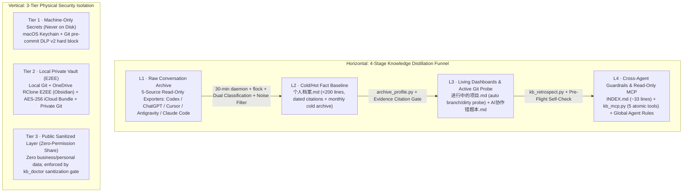
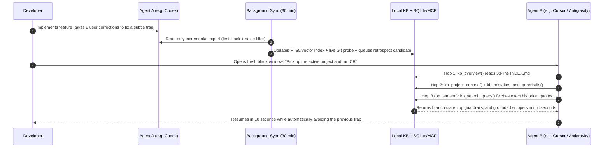

# agent-memory-kb

[](https://github.com/JaydenWuGang123/agent-memory-kb/actions/workflows/ci.yml)
[](LICENSE)
[](https://www.python.org/)
[](#1-why-agent-memory-kb)

[简体中文详细文档 (README.zh-CN.md)](README.zh-CN.md)

**A local-first, Git-backed, AI-native Personal Knowledge Base & Read-Only MCP Server for multi-agent developers** — uniting **Codex, Claude Code, Cursor, Antigravity, and ChatGPT** around one structured, privacy-safe, self-evolving brain on your own machine.

> **Core Philosophy**: *In the AI coding era, the first reader of your knowledge base is your Agent — not you.*
> Instead of manually maintaining folders in a closed cloud SaaS app, `agent-memory-kb` provides a **local Context Engineering infrastructure**: it automatically archives conversations across 5 AI tools, probes live Git states of your active repositories, turns repeated AI mistakes into persistent guardrails, and serves low-token context to every coding agent via **3-Hop Progressive Disclosure + Offline Hybrid Search + Read-Only MCP**.

---

## Table of Contents

1. [Why `agent-memory-kb`?](#1-why-agent-memory-kb)
2. [Before vs. After](#2-before-vs-after)
3. [Architecture & Multi-Agent Handoff Flow](#3-architecture--multi-agent-handoff-flow)
4. [Deep Dive Into Core Mechanisms](#4-deep-dive-into-core-mechanisms)
   - [4.1 5-Source Read-Only Exporters & Dual Classification](#41-5-source-read-only-exporters--dual-classification)
   - [4.2 3-Hop Progressive Disclosure & Token Economics](#42-3-hop-progressive-disclosure--token-economics)
   - [4.3 Offline CJK Hybrid Search (FTS5 + INT8 ONNX + RRF)](#43-offline-cjk-hybrid-search-fts5--int8-onnx--rrf)
   - [4.4 Read-Only MCP Server API Reference (5 Atomic Tools)](#44-read-only-mcp-server-api-reference-5-atomic-tools)
   - [4.5 Anti-Hallucination Evidence Chain & Monthly Cold Archiving](#45-anti-hallucination-evidence-chain--monthly-cold-archiving)
   - [4.6 Self-Evolving AI Mistake Book](#46-self-evolving-ai-mistake-book)
   - [4.7 Industrial DLP v2, 7-Dimension Health Doctor & 4-Way DR](#47-industrial-dlp-v2-7-dimension-health-doctor--4-way-dr)
5. [Generated Knowledge Base Anatomy](#5-generated-knowledge-base-anatomy)
6. [Complete 16-Script Reference](#6-complete-16-script-reference)
7. [Full `kb_config.json` Reference](#7-full-kb_configjson-reference)
8. [5-Minute Zero-to-Production Setup](#8-5-minute-zero-to-production-setup)
9. [Daily CLI Cheat Sheet](#9-daily-cli-cheat-sheet)
10. [Team Adoption & Enterprise Compliance](#10-team-adoption--enterprise-compliance)
11. [Running Automated Tests](#11-running-automated-tests)
12. [FAQ](#12-faq)
13. [License](#13-license)

---

## 1. Why `agent-memory-kb`?

Developers juggling multiple AI coding agents every day hit the same four structural walls:

1. **Fragmented Memory & Context Amnesia**: Hundreds of sessions and tens of thousands of messages are trapped inside Codex, Cursor, Claude Code, Antigravity, and ChatGPT silos. Switching windows means wasting 5–15 minutes re-explaining your branch, blockers, and decisions.
2. **Context Rot & Token Waste**: Pasting giant chat logs or dumping massive rule files into every system prompt burns subscription quotas and dilutes model attention.
3. **Repeated AI Mistakes ("Rework Tax")**: You spend 3 turns fixing a subtle trap today (e.g., falsy `0` dropped by `Boolean`, wrong API field mapping, Mock pass confused with real backend integration), and tomorrow a fresh session repeats the exact same mistake.
4. **Privacy, Governance & Backup Risk**: Cloud memory services require sending private code context to third-party APIs; DIY local folders risk committing plaintext secrets, colliding with team standards, or losing months of work when a laptop fails.

---

## 2. Before vs. After

| Dimension | Traditional Notes / Ad-Hoc Prompts | `agent-memory-kb` (Agent-First) |
| --- | --- | --- |
| **Capture Friction** | Manual copy-paste; breaks coding flow, abandoned in 2 weeks | Background `launchd` sync every 30 min across 5 AI tools (read-only, zero friction) |
| **Cross-Agent Handoff** | 5–15 min re-explaining branch, blockers, and prior decisions | **~10 seconds**: Agent reads 30-line `INDEX.md` → live Git-probed project dashboard |
| **Initial Token Cost** | ~12,000–25,000 tokens/session pasting history or giant rules | **~3,000 tokens** via 3-Hop Progressive Disclosure + local SQLite Top-K retrieval |
| **Hallucination Control** | Assumptions, Mock passes, and real API tests mixed together | Strict **dated evidence citations** & explicit verification boundaries + cold archiving |
| **Mistake Prevention** | Same bugs recur across sessions and burn CR/debugging time | Auto-detects multi-correction sessions → deduplicated `[复发 xN]` guardrails |
| **Security & Backup** | Cloud SaaS lock-in or unguarded local folders | 100% local Markdown + Keychain AES-256 + DLP `pre-commit` hook + 4-way verify |

---

## 3. Architecture & Multi-Agent Handoff Flow

### 3.1 4-Stage Knowledge Funnel × 3-Tier Security Isolation



### 3.2 Multi-Agent Handoff & Self-Check Sequence



---

## 4. Deep Dive Into Core Mechanisms

### 4.1 5-Source Read-Only Exporters & Dual Classification
- **Strictly Read-Only Adapters**: `export_codex.py`, `export_cursor.py`, `export_antigravity.py`, `export_claude.py`, and `export_chatgpt.py` read local SQLite/JSONL/export sources in read-only mode without locking or mutating any host tool database.
- **Production Reliability**:
  - `fcntl.flock` exclusive process lock prevents concurrent background runs from corrupting Git or SQLite;
  - Per-exporter **180-second timeout circuit breaker** ensures one slow source never blocks the other four;
  - Filters out noisy internal `thinking` blocks, huge `tool_call` dumps, empty sessions, and trivial greetings (`noise_filter` in `kb_config.json`).
- **Dual-Stage Classification**: Matches semantic keywords in conversation titles first (`title_categories`), then falls back to workspace path (`cwd_categories`), drastically shrinking the uncategorized bucket.
- **Idempotent Git Commits**: Only commits when meaningful file diffs exist — zero noisy empty commits.

### 4.2 3-Hop Progressive Disclosure & Token Economics
- **Hop 1 (~400 tokens)**: Reads the ~30-line `INDEX.md` routing map.
- **Hop 2 (~1,100 tokens)**: Loads only the relevant living note (`笔记/进行中的项目.md` with auto-probed Git status or `笔记/AI协作错题本.md`). 80% of daily tasks start coding right here.
- **Hop 3 (~1,500 tokens, on demand)**: Queries local SQLite via MCP for Top-K historical quotes *only* when a past contract or decision needs verification.
- Keeps 20,000+ archived messages in local SQLite instead of your prompt window — cutting initial context overhead by ~85%.

### 4.3 Offline CJK Hybrid Search (FTS5 + INT8 ONNX + RRF)
Standard SQLite FTS5 tokenizers fail on Chinese/CJK text. `agent-memory-kb` combines two 100% offline retrieval paths with zero API cost:
1. **Lexical Path (`fts`)**: SQLite FTS5 (`contentless_delete=1`) with **CJK unigram + Latin/identifier tokenization**, configurable synonym expansion (`synonyms`), multi-term `AND`, and natural-language query rescue — ideal for exact error codes, field names, and file paths.
2. **Semantic Path (`semantic`)**: `kb_embed.py` runs a lightweight local **INT8 ONNX** multilingual model on CPU with content-hash incremental caching — ideal when you remember the concept but not the exact phrase.
3. **Reciprocal Rank Fusion (`hybrid`)**: Fuses both result lists via $\text{score} = \sum \frac{1}{k + \text{rank}}$, caps hits per conversation (`per_conv`) to avoid spam, and prioritizes recent updates (`updated_at`).

### 4.4 Read-Only MCP Server API Reference (5 Atomic Tools)

`scripts/kb_mcp.py` exposes **5 strictly read-only tools** anchored to `AGENT_MEMORY_KB_ROOT` (default `~/personal-kb`):

| Tool | Parameters & Defaults | Purpose | Security |
| --- | --- | --- | --- |
| `kb_overview()` | none | Returns `INDEX.md`, living-note listing, and SQLite index statistics | Read-only |
| `kb_project_context(cwd_or_project)` | `cwd_or_project: str` | Extracts matching active project checkpoints & live Git probe status from `笔记/进行中的项目.md` | Read-only |
| `kb_mistakes_and_guardrails(include_pending=True)` | `include_pending: bool = True` | Returns top anti-mistake guardrails from `笔记/AI协作错题本.md` plus optional pending retrospect queue | Read-only |
| `kb_search_query(query, mode="hybrid", source="all", limit=8)` | `query: str`, `mode: "fts"\|"semantic"\|"hybrid"`, `source: "all"\|"notes"\|"codex"\|...`, `limit: int` | Runs FTS5 / semantic / RRF hybrid search and returns ranked JSON snippets with file paths & dates | Read-only |
| `kb_read_note(rel_path, start_line=1, max_lines=160)` | `rel_path: str`, `start_line: int = 1`, `max_lines: int = 160` | Reads bounded line ranges of a note inside the KB | **Strict path-traversal guard** confined to KB root |

### 4.5 Anti-Hallucination Evidence Chain & Monthly Cold Archiving
- **Facts vs. Suggestions**: Only user-confirmed statements with dates and source anchors enter `个人档案.md`; AI suggestions never auto-promote to facts.
- **Explicit Verification Boundaries**: Distinguishes *user-confirmed口径*, *Mock-only verification*, and *real backend integration* so future sessions never build on false assumptions.
- **Cold/Hot Tiering (`archive_profile.py`)**: Once `个人档案.md` exceeds `profile_auto_archive_lines` (default 260), older monthly sections automatically archive into `笔记/历史档案/` with relative Markdown links rebased cleanly.

### 4.6 Self-Evolving AI Mistake Book
- `kb_retrospect.py scan` scans recent archived conversations for multi-correction high-friction sessions and queues them in `_同步/retrospect-queue.json` and `笔记/AI协作错题本.md`.
- Recurring root causes are deduplicated with `[复发 xN]` counters; once distilled, run `kb_retrospect.py resolve --path "<rel_path>"` to close the candidate.
- Every new agent session loads the top guardrails before editing code.

### 4.7 Industrial DLP v2, 7-Dimension Health Doctor & 4-Way DR
- **DLP v2 (`kb_filters.py`)**: Wired into `.git/hooks/pre-commit`, blocking JWTs, Bearer tokens, Cookies, DB DSN passwords, `.env` keys, ID numbers, private key blocks, high-entropy contextual secrets, and custom `sanitization_extra_patterns`.
- **7-Dimension Health Doctor (`kb_doctor.py`)**: Audits broken links, missing citations, line budgets, secret leaks, public-dir sanitization violations, config integrity, and stale project notes (`staleness_warn_days`, default 14).
- **4-Way Disaster Recovery (`kb_backup.py` + `kb_restore_verify.py`)**:
  1. Local Git repository (with automatic `git gc` above `git_gc_loose_threshold`);
  2. Atomic local `git bundle`;
  3. macOS Keychain **AES-256 encrypted iCloud bundle** (with round-trip decrypt check & resilient orphan `.tmp.*` cleanup);
  4. Private Git remote (with an anti-public-URL safety check rejecting remotes containing `public`);
  5. Automated isolated-directory restore drill verifying identical Git `HEAD` hashes across all 4 copies.

---

## 5. Generated Knowledge Base Anatomy

After running `python3 init_kb.py --root ~/personal-kb`, your local KB looks like this:

```text
~/personal-kb/
├── INDEX.md                       # Hop-1 routing map (~30 lines) for all AI agents
├── 个人档案.md                     # L2 hot fact baseline (dated citations, auto cold-archived)
├── 对话索引.md                     # Auto-generated catalog of 5-source archived chats
├── 跨设备配置.md                   # Obsidian + Remotely Save (OneDrive E2EE) mobile guide
├── 笔记/
│   ├── 进行中的项目.md             # L3 live project board with auto-probed Git status
│   ├── AI协作错题本.md             # L3/L4 top guardrails + [复发 xN] mistake log
│   ├── 知识库架构与治理.md         # Governance rules & maintenance thresholds
│   └── 历史档案/                   # Monthly cold archives from archive_profile.py
├── 对话/                           # L1 read-only archived Markdown by AI tool
│   ├── Codex/
│   ├── Cursor/
│   ├── Antigravity/
│   ├── ClaudeCode/
│   └── ChatGPT/
├── 共享摘录/                       # Tier 3 public sanitized zone (enforced by kb_doctor)
└── _同步/                          # All 16 scripts, SQLite index, and sync reports
    ├── kb_config.json             # Single user configuration file
    ├── kb_search.sqlite           # Local FTS5 + vector DB (.gitignored)
    ├── 同步报告.md                 # Transparent incremental sync & gap report
    └── *.py
```

---

## 6. Complete 16-Script Reference

| Script | Purpose | Dependencies |
| --- | --- | --- |
| `init_kb.py` | Bootstraps directory layout, templates, config, Git repo, and DLP `pre-commit` hook | Python 3.9+ stdlib |
| `scripts/export_codex.py` | Read-only incremental exporter for Codex sessions | Python stdlib |
| `scripts/export_cursor.py` | Read-only incremental exporter for Cursor workspace SQLite chats | Python stdlib |
| `scripts/export_antigravity.py` | Read-only incremental exporter for Antigravity transcripts | Python stdlib |
| `scripts/export_claude.py` | Read-only incremental exporter for Claude Code (filters thinking/tool blocks) | Python stdlib |
| `scripts/export_chatgpt.py` | Incremental importer/normalizer for ChatGPT exports | Python stdlib |
| `scripts/build_kb_index.py` | Main orchestrator: `flock`, 180s timeout, dual classification, live Git probe, FTS5 index, idempotent commit | Python stdlib |
| `scripts/kb_search.py` | CLI & library for `fts`, `semantic`, and `hybrid` (RRF) search | Stdlib (`fts`); optional ONNX |
| `scripts/kb_embed.py` | Offline INT8 ONNX embedding builder with content-hash caching | Optional (`requirements.txt`) |
| `scripts/kb_mcp.py` | Standard Read-Only MCP server exposing 5 tools to AI agents | Optional (`mcp`) |
| `scripts/kb_retrospect.py` | Multi-correction detector & mistake-book review queue manager | Python stdlib |
| `scripts/archive_profile.py` | Monthly cold-archiver for `个人档案.md` with automatic link rebasing | Python stdlib |
| `scripts/kb_filters.py` | DLP v2 secret redaction, noise filters, and sanitization rules | Python stdlib |
| `scripts/kb_doctor.py` | 7-dimension health gate outputting structured JSON | Python stdlib |
| `scripts/kb_backup.py` | Atomic `git bundle` + Keychain AES-256 iCloud mirror + private Git remote | Stdlib + `openssl` |
| `scripts/kb_restore_verify.py` | Isolated restore drill verifying 4-way Git `HEAD` parity | Stdlib + `openssl` |
| `scripts/test_kb_pipeline.py` | 16 automated regression unit tests covering the full pipeline | Python stdlib |

---

## 7. Full `kb_config.json` Reference

Customize everything in `~/personal-kb/_同步/kb_config.json` without touching script code:

```json
{
  "active_repos": [
    {"name": "my-frontend-app", "path": "/Users/you/workspace/my-frontend-app"},
    {"name": "my-backend-api", "path": "/Users/you/workspace/my-backend-api"}
  ],
  "cwd_categories": [
    ["工程与工作项目", "/work/|/projects/|frontend|backend"],
    ["产品与个人项目", "side-project|indie|personal-project"],
    ["学习与成长", "learning|study|agent-memory-kb"]
  ],
  "title_categories": [
    ["工程与工作项目", "前端|后端|设计文档|接口|组件|React|Vue|TypeScript|Python|bug|修复|重构|CI"],
    ["工具与效率", "Codex|ChatGPT|Claude|Cursor|Antigravity|Skill|MCP|Obsidian|自动化"]
  ],
  "synonyms": [
    ["个人知识库", "PKM", "知识库"],
    ["容灾", "灾备", "备份"]
  ],
  "sanitization_extra_patterns": [],
  "extra_public_dirs": [],
  "git_gc_loose_threshold": 300,
  "icloud_lag_warn_hours": 4,
  "restore_verify_interval_hours": 24,
  "profile_auto_archive_lines": 260,
  "staleness_warn_days": 14,
  "macos_notify_on_error": true,
  "alert_cooldown_hours": 12,
  "private_git_remote": "private-backup",
  "noise_filter": {
    "drop_zero_message": true,
    "probe_title_regex": "^Reply (?:with )?exactly (?:[A-Z0-9_]+_)?OK\\b",
    "trivial_user_regex": "^(?:你好|您好|hi|hello)[!！?？。.,，\\s]*$",
    "excluded_ids": []
  }
}
```

---

## 8. 5-Minute Zero-to-Production Setup

### Step 1. Clone & Initialize

```bash
git clone https://github.com/JaydenWuGang123/agent-memory-kb.git
cd agent-memory-kb

python3 init_kb.py --root ~/personal-kb
```

### Step 2. First Sync, Health Check & Search (Stdlib Only)

```bash
python3 ~/personal-kb/_同步/build_kb_index.py --output-root ~/personal-kb --skip-icloud
python3 ~/personal-kb/_同步/kb_doctor.py --root ~/personal-kb
python3 ~/personal-kb/_同步/kb_search.py --root ~/personal-kb -q "your query" --mode fts
```

### Step 3. Connect Read-Only MCP & Offline Semantic Vectors (Optional)

```bash
pip install -r requirements.txt
```

Register `kb_mcp.py` in Codex / Cursor / Claude Code / Antigravity ([`examples/mcp_config.example.json`](examples/mcp_config.example.json)):

```json
{
  "mcpServers": {
    "personal-kb": {
      "command": "/usr/local/bin/python3",
      "args": ["/Users/YOUR_NAME/personal-kb/_同步/kb_mcp.py"],
      "env": {
        "AGENT_MEMORY_KB_ROOT": "/Users/YOUR_NAME/personal-kb"
      }
    }
  }
}
```

Drop [`examples/agent-rules.md`](examples/agent-rules.md) into your global agent instructions (`AGENTS.md` / `CLAUDE.md` / `GEMINI.md`).

### Step 4. Enable 30-Minute Background Sync & Encrypted Backup (macOS)

1. Copy [`examples/personal-kb-sync.sh.example`](examples/personal-kb-sync.sh.example) to `~/.local/bin/personal-kb-sync.sh` and `chmod +x`.
2. Save an encryption passphrase in macOS Keychain:
   ```bash
   security add-generic-password -U -a "$USER" -s "agent-memory-kb.icloud-bundle" -w
   ```
3. Load [`examples/launchd.personal-kb-sync.plist.example`](examples/launchd.personal-kb-sync.plist.example) into `~/Library/LaunchAgents/`. *(Grant `/bin/zsh` Full Disk Access if mirroring to iCloud Drive in background.)*

### Step 5. Zero-Cost E2EE Mobile Sync (Obsidian + OneDrive)

Open `~/personal-kb` in Obsidian and follow [`templates/跨设备配置.md`](templates/跨设备配置.md) to configure **Remotely Save** (OneDrive App Folder + **RClone Crypt E2EE**) across Mac, iPhone, Android, and Windows.

---

## 9. Daily CLI Cheat Sheet

```bash
# Hybrid RRF search (JSON output)
python3 ~/personal-kb/_同步/kb_search.py --root ~/personal-kb -q "field mapping" --mode hybrid --json

# Search curated notes only
python3 ~/personal-kb/_同步/kb_search.py --root ~/personal-kb -q "backup" --source notes --limit 5

# Scan for multi-correction high-friction sessions
python3 ~/personal-kb/_同步/kb_retrospect.py --root ~/personal-kb scan

# Mark a retrospect candidate as distilled
python3 ~/personal-kb/_同步/kb_retrospect.py --root ~/personal-kb resolve --path "对话/Codex/xxx.md"

# Run 4-way disaster recovery drill (including iCloud AES-256 decrypt verify)
python3 ~/personal-kb/_同步/kb_restore_verify.py --root ~/personal-kb --check-icloud

# Strict health check including staleness audit
python3 ~/personal-kb/_同步/kb_doctor.py --root ~/personal-kb --strict-staleness
```

---

## 10. Team Adoption & Enterprise Compliance

- **100% Intranet-Ready**: Point `private_git_remote` to your company's internal GitLab instance — zero third-party SaaS lock-in, zero external cloud fees.
- **SSOT Separation**: Keep shared team standards strictly read-only at the highest priority; incubate personal learnings in your local mistake book first, then promote high-recurrence `[复发 xN]` findings into team standards via normal MR review.
- **3-Phase Rollout**: Week 1 individual 30-min pilot → Month 1 shared team mistake book → Quarter 1 read-only team MCP knowledge base for faster onboarding.

---

## 11. Running Automated Tests

```bash
PERSONAL_KB_SKIP_KEYCHAIN=1 python3 -m unittest discover -s scripts -p 'test_*.py' -v
```

All **16 regression tests** complete in ~7 seconds and run continuously on Python 3.11 & 3.12 via GitHub Actions CI.

---

## 12. FAQ

- **Does it upload my code or private notes to any cloud?**
  No. Everything stays 100% local in Markdown, Git, and SQLite. Optional backups go only to targets you control (private GitLab/GitHub, AES-256 iCloud bundle, or E2EE OneDrive App Folder).
- **Can I use it with an internal enterprise GitLab?**
  Yes — just set `private_git_remote` to your internal GitLab remote.
- **Do I need a GPU or paid embedding API for semantic search?**
  No. `kb_embed.py` runs an offline INT8 ONNX model on CPU with content-hash caching, and `--mode fts` works with pure Python stdlib and zero extra packages.
- **Will exporters modify or lock my Codex / Cursor / Claude databases?**
  No. Every exporter is strictly read-only with a 180-second timeout circuit breaker.
- **How does it stay fast and clean after a year of heavy use?**
  `kb_doctor.py` enforces line budgets on hot notes, and `archive_profile.py` automatically cold-archives older monthly sections while rebasing relative links.
- **Does it work on Linux or Windows?**
  All core scripts (init, search, doctor, MCP, tests, Git snapshots) are cross-platform. Only macOS Keychain and `launchd` are macOS-specific and can be replaced with `systemd`/Task Scheduler + env passphrases.

---

## 13. License

[MIT](LICENSE) — Stars, Issues, and PRs are welcome!
