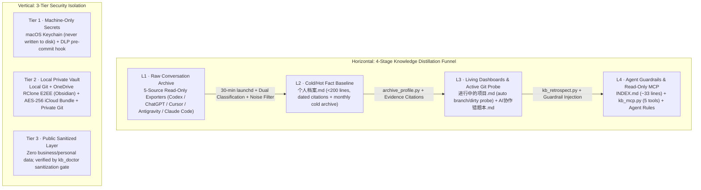

# agent-memory-kb

[](https://github.com/JaydenWuGang123/agent-memory-kb/actions/workflows/ci.yml)
[](LICENSE)
[](https://www.python.org/)
[](#why-agent-memory-kb)

[简体中文文档 (README.zh-CN.md)](README.zh-CN.md)

**A local-first, Git-backed, AI-native Personal Knowledge Base & Read-Only MCP Server for multi-agent developers** — connecting **Codex, Claude Code, Cursor, Antigravity, and ChatGPT** to one shared, structured, privacy-safe brain on your own machine.

> **Core Philosophy**: *In the AI coding era, the first reader of your knowledge base is your Agent — not you.*
> Instead of manually curating folders in a closed cloud SaaS app, `agent-memory-kb` automatically archives conversations, distills verified facts and active project checkpoints, prevents repeated AI mistakes, and serves precise context to every coding agent via **3-Hop Progressive Disclosure + Offline Hybrid Search + Read-Only MCP**.

---

## Table of Contents

- [Why `agent-memory-kb`?](#why-agent-memory-kb)
- [Before vs. After](#before-vs-after)
- [Architecture: 4-Stage Funnel × 3-Tier Security Isolation](#architecture-4-stage-funnel--3-tier-security-isolation)
- [How It Works Under the Hood](#how-it-works-under-the-hood)
- [Repository & Script Reference](#repository--script-reference)
- [5-Minute Quickstart](#5-minute-quickstart)
- [Running Tests](#running-tests)
- [FAQ](#faq)
- [License](#license)

---

## Why `agent-memory-kb`?

Developers using multiple AI coding agents every day run into the same four structural walls:

1. **Fragmented Memory & Context Amnesia**: Hundreds of conversations and decisions are trapped inside Codex, Cursor, Claude Code, Antigravity, and ChatGPT silos. Switching windows means spending 5–15 minutes re-explaining your project.
2. **Context Rot & Token Waste**: Pasting long chat histories or dumping huge rule files into every prompt burns through subscription quotas and degrades model focus.
3. **Repeated AI Mistakes ("Rework Tax")**: You correct an agent three times today (e.g., falsy `0` handling, wrong API field mapping, stale DOM state), and tomorrow a brand-new session makes the exact same mistake.
4. **Privacy, Governance & Backup Anxiety**: Cloud memory APIs require uploading private code/work context to third-party servers; ad-hoc local folders risk leaking secrets to Git or losing months of notes when a laptop dies.

---

## Before vs. After

| Dimension | Traditional Notes / Ad-Hoc Prompts | `agent-memory-kb` (Agent-First) |
| --- | --- | --- |
| **Memory Capture** | Manual copy-paste; breaks coding flow, abandoned in 2 weeks | Background `launchd` sync every 30 min across 5 AI tools (read-only, zero friction) |
| **Cross-Agent Handoff** | 5–15 min re-explaining repo branch, blockers, and decisions | **10 seconds**: Agent reads 30-line `INDEX.md` → live Git-probed project board |
| **Token Overhead** | ~12k–25k tokens/session pasting history or giant rule dumps | **~3k tokens** via 3-Hop Progressive Disclosure + Top-K local SQLite retrieval |
| **Hallucination Control** | Assumptions, Mock passes, and real API tests mixed together | Strict **evidence anchors** (`date + source link`) & explicit verification boundaries |
| **Repeated Mistakes** | Same bugs keep recurring across sessions | Auto-detects multi-correction sessions → deduplicated `[复发 xN]` guardrails |
| **Security & Backup** | Cloud SaaS lock-in or unencrypted local folders | 100% local Markdown + Keychain AES-256 + DLP `pre-commit` hook + 4-way verify |

---

## Architecture: 4-Stage Funnel × 3-Tier Security Isolation



---

## How It Works Under the Hood

### 1. Three-Hop Progressive Disclosure (Low-Token Recall)
Instead of stuffing your entire knowledge base into system prompts, every connected AI agent follows a disciplined 3-hop path:
- **Hop 1 (`kb_overview` / `INDEX.md`)**: Reads a compact ~30-line map telling the agent *where* each category of knowledge lives.
- **Hop 2 (`kb_project_context` / `kb_mistakes_and_guardrails`)**: Loads only the active project checkpoint board (with live Git branch, dirty file count, and latest commit auto-probed from your local repos) and your top anti-mistake rules.
- **Hop 3 (`kb_search_query` / `kb_read_note`)**: Drills down into the 20,000+ archived messages **only when needed**, returning precise Top-K snippets from local SQLite.

### 2. Offline CJK Hybrid Search (`kb_search.py` + `kb_embed.py`)
Standard SQLite FTS5 does not tokenize Chinese/CJK text well. `agent-memory-kb` combines two completely offline retrieval paths with zero API fees:
- **Path A (Lexical)**: SQLite FTS5 (`contentless_delete=1`) with **CJK unigram tokenization + Latin/identifier tokens**, multi-term `AND` matching, and natural-language query rescue — great for exact error codes, API field names, and file paths.
- **Path B (Semantic)**: Local offline **INT8 ONNX** multilingual embeddings with content-hash incremental caching — great when you remember the *meaning* but forgot the exact wording.
- **Fusion**: Merges both lists via **Reciprocal Rank Fusion (RRF)**, caps snippets per conversation to prevent spam, and boosts recent updates (`updated_at`).

### 3. Native Read-Only MCP Server (`kb_mcp.py`)
One lightweight Python MCP server exposes **5 read-only atomic tools** to Codex, Cursor, Claude Code, and Antigravity simultaneously:
- `kb_overview` — returns the first-hop `INDEX.md` map.
- `kb_project_context` — returns active project checkpoints & real-time Git repo status.
- `kb_mistakes_and_guardrails` — returns high-frequency AI collaboration guardrails before coding starts.
- `kb_search_query` — runs FTS5 / semantic / hybrid RRF search across all notes & archived chats.
- `kb_read_note` — reads bounded line ranges inside the KB root with strict path-traversal protection.

### 4. Self-Evolving AI Mistake Book (`kb_retrospect.py`)
When a coding session takes multiple user corrections to get right, `kb_retrospect.py` detects those high-friction conversations, queues them for distillation, merges duplicate root causes with recurrence counters (`[复发 xN]`), and promotes recurring traps into top-level guardrails loaded by all agents.

### 5. Industrial DLP, Health Checks & 4-Way Disaster Recovery
- **DLP v2 & Health Gate (`kb_filters.py` + `kb_doctor.py`)**: Bound to `.git/hooks/pre-commit`. Scans for JWTs, Bearer tokens, Cookies, DB DSN passwords, `.env` keys, ID numbers, high-entropy secrets, broken Markdown links, missing citations, line-budget overflows, stale notes, and sanitization leaks.
- **4-Way Backup & Restore Drill (`kb_backup.py` + `kb_restore_verify.py`)**: Maintains (1) Local Git, (2) Atomic local `git bundle`, (3) Keychain **AES-256 encrypted iCloud bundle** (with round-trip decrypt check & orphan `.tmp.*` cleanup), and (4) Private Git remote (with an anti-public-URL safety check). `kb_restore_verify.py` verifies that all 4 copies match the exact same Git `HEAD` hash.

---

## Repository & Script Reference

```text
agent-memory-kb/
├── init_kb.py                # One-command bootstrapper for a fresh local KB
├── requirements.txt          # Optional deps for MCP server & local ONNX embeddings
├── scripts/                  # 16 core Python modules + full unittest suite
├── templates/                # Starter Markdown templates & kb_config.example.json
├── examples/                 # MCP config, global agent rules, macOS launchd plist
└── .github/workflows/ci.yml  # GitHub Actions CI (Python 3.11 & 3.12)
```

| Script | Purpose | Dependencies |
| --- | --- | --- |
| `init_kb.py` | Initializes a ready-to-use KB directory, Git repo, templates, and pre-commit hook | Python stdlib |
| `scripts/export_codex.py` | Read-only incremental exporter for local Codex sessions | Python stdlib |
| `scripts/export_cursor.py` | Read-only incremental exporter for Cursor workspace SQLite chats | Python stdlib |
| `scripts/export_antigravity.py` | Read-only incremental exporter for Antigravity conversation logs | Python stdlib |
| `scripts/export_claude.py` | Read-only incremental exporter for Claude Code sessions (filters tool/thinking noise) | Python stdlib |
| `scripts/export_chatgpt.py` | Incremental importer/normalizer for ChatGPT exports | Python stdlib |
| `scripts/build_kb_index.py` | Main orchestrator: runs exporters (with `fcntl.flock` & 180s timeout), dual classification, live Git probe, FTS5 index, and idempotent Git commit | Python stdlib |
| `scripts/kb_search.py` | CLI & library for `fts`, `semantic`, and `hybrid` (RRF) search | Stdlib (`fts`); optional ONNX (`hybrid`) |
| `scripts/kb_embed.py` | Offline INT8 ONNX embedding builder with content-hash caching | Optional (`requirements.txt`) |
| `scripts/kb_mcp.py` | Standard Read-Only MCP server exposing 5 tools to AI coding agents | Optional (`mcp`) |
| `scripts/kb_retrospect.py` | Detects multi-correction high-friction sessions & manages the mistake-book queue | Python stdlib |
| `scripts/archive_profile.py` | Monthly cold-archiver for `个人档案.md` that rebases relative links automatically | Python stdlib |
| `scripts/kb_filters.py` | DLP v2 secret redaction, noise filtering, and sanitization rules | Python stdlib |
| `scripts/kb_doctor.py` | 7-dimension health checker (links, citations, budgets, DLP, staleness, config) | Python stdlib |
| `scripts/kb_backup.py` | Atomic `git bundle` + Keychain AES-256 iCloud mirror + private remote sync | Python stdlib + `openssl` |
| `scripts/kb_restore_verify.py` | End-to-end disaster recovery drill verifying 4-way Git `HEAD` parity | Python stdlib + `openssl` |
| `scripts/test_kb_pipeline.py` | 16 automated regression unit tests covering the entire pipeline | Python stdlib |

---

## 5-Minute Quickstart

### Step 1. Clone & Initialize Your Local Knowledge Base

```bash
git clone https://github.com/JaydenWuGang123/agent-memory-kb.git
cd agent-memory-kb

# Bootstrap a fresh local KB repo (defaults to ~/personal-kb)
python3 init_kb.py --root ~/personal-kb
```

This creates `~/personal-kb` with `INDEX.md`, starter living notes under `笔记/`, `_同步/kb_config.json`, all 16 scripts, and a Git repository with the DLP `pre-commit` hook pre-wired.

### Step 2. Configure Your Active Repos (Optional)

Edit `~/personal-kb/_同步/kb_config.json` to list the local Git repositories you want the live Git probe to track in `笔记/进行中的项目.md`, plus any custom category keywords.

### Step 3. Run Your First Sync, Health Check & Search (Zero External Dependencies)

Core indexing, FTS5 search, DLP checks, Git snapshots, and backup verification only require **Python 3.9+ stdlib**:

```bash
python3 ~/personal-kb/_同步/build_kb_index.py --output-root ~/personal-kb --skip-icloud
python3 ~/personal-kb/_同步/kb_doctor.py --root ~/personal-kb
python3 ~/personal-kb/_同步/kb_search.py --root ~/personal-kb -q "your query" --mode fts
```

A healthy initial output from `kb_doctor.py` looks like:
```json
{
  "healthy": true,
  "broken_links": [],
  "missing_citations": [],
  "budget_warnings": [],
  "sanitization_violations": [],
  "secret_leaks": []
}
```

### Step 4. (Optional) Enable Read-Only MCP Server & Local ONNX Semantic Vectors

```bash
pip install -r requirements.txt
```

1. Register `~/personal-kb/_同步/kb_mcp.py` in Codex / Cursor / Claude Code / Antigravity using [`examples/mcp_config.example.json`](examples/mcp_config.example.json).
2. Add [`examples/agent-rules.md`](examples/agent-rules.md) to your global agent instructions (`AGENTS.md` / `CLAUDE.md` / `GEMINI.md`) so agents automatically check `INDEX.md` and your mistake book before starting work.

### Step 5. (Optional) Enable 30-Minute Background Sync & Encrypted Backup (macOS)

1. Copy [`examples/personal-kb-sync.sh.example`](examples/personal-kb-sync.sh.example) to `~/.local/bin/personal-kb-sync.sh` and run `chmod +x ~/.local/bin/personal-kb-sync.sh`.
2. Store an encryption passphrase in macOS Keychain (never saved to plaintext files):
   ```bash
   security add-generic-password -U -a "$USER" -s "agent-memory-kb.icloud-bundle" -w
   ```
3. Load [`examples/launchd.personal-kb-sync.plist.example`](examples/launchd.personal-kb-sync.plist.example) into `~/Library/LaunchAgents/`. *(If mirroring to iCloud Drive in the background, grant `/bin/zsh` Full Disk Access in macOS System Settings.)*
4. **Zero-cost E2EE Mobile Sync**: Open `~/personal-kb` as an Obsidian vault and follow [`templates/跨设备配置.md`](templates/跨设备配置.md) to sync via **Remotely Save (OneDrive App Folder + RClone Crypt)** to iPhone/Android.

---

## Running Tests

```bash
PERSONAL_KB_SKIP_KEYCHAIN=1 python3 -m unittest discover -s scripts -p 'test_*.py' -v
```

All **16 regression tests** run in ~7 seconds and are continuously verified on Python 3.11 & 3.12 via GitHub Actions CI.

---

## FAQ

- **Does `agent-memory-kb` upload my code or notes to any third-party cloud?**
  No. Everything runs 100% locally in plain Markdown, Git, and SQLite. Optional backups go only to targets *you* configure (your private GitHub/GitLab repo, encrypted iCloud bundle, or E2EE OneDrive App Folder).
- **Can I use this inside a company with internal GitLab?**
  Yes. Just point the private backup remote in your local KB repo to your internal GitLab repository — zero external SaaS dependencies and 100% intranet-compatible.
- **Do I need a GPU for hybrid semantic search?**
  No. `kb_embed.py` uses a lightweight local INT8 ONNX multilingual model on CPU with content-hash caching, and you can also use `--mode fts` with pure Python stdlib and zero extra packages.
- **Will the exporters modify or lock my Codex / Cursor / Claude databases?**
  No. Every exporter opens source data strictly read-only and isolates timeouts (180s) so one source never blocks the others.
- **How do I prevent the knowledge base from getting bloated after a year?**
  `kb_doctor.py` enforces line budgets on `INDEX.md` and hot notes, while `archive_profile.py` automatically cold-archives older monthly sections and rebases relative Markdown links.

---

## License

[MIT](LICENSE)
