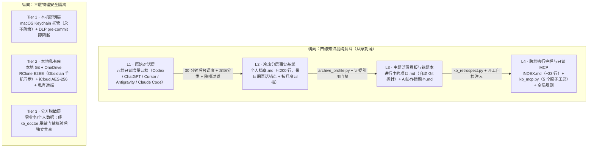

# agent-memory-kb（AI 原生个人知识库与跨端共享记忆引擎）

[](https://github.com/JaydenWuGang123/agent-memory-kb/actions/workflows/ci.yml)
[](LICENSE)
[](https://www.python.org/)
[](#为什么做-agent-memory-kb)

[English README](README.md)

面向重度使用多个 Coding Agent 的开发者（**Codex / Claude Code / Cursor / Antigravity / ChatGPT**）的**本地优先（Local-First）、Git 驱动、自带离线混合检索 MCP + 错题本自进化 + 工业级防漏容灾**个人知识库引擎。

> **核心理念**：*AI 时代的知识库，第一读者不是人，是 Agent。*
> 告别在闭源云端笔记里手动建目录、贴聊天记录；`agent-memory-kb` 帮你把多端对话在后台自动归档，提炼为带证据锚点的事实基线、实时项目断点看板和自动防重犯错题本，再通过 **3 跳渐进式披露 + 本地离线混合检索 + 只读 MCP** 毫秒级供给任意 AI 编程助手。

---

## 目录

- [为什么做 `agent-memory-kb`？](#为什么做-agent-memory-kb)
- [使用前后对比](#使用前后对比)
- [全景架构：四级漏斗 × 三层安全隔离](#全景架构四级漏斗--三层安全隔离)
- [核心机制原理解析](#核心机制原理解析)
- [仓库结构与 16 个脚本速查表](#仓库结构与-16-个脚本速查表)
- [5 分钟快速上手](#5-分钟快速上手)
- [运行单元测试](#运行单元测试)
- [常见问题（FAQ）](#常见问题faq)
- [开源协议](#开源协议)

---

## 为什么做 `agent-memory-kb`？

日常同时开多个 AI 工具写代码、做设计时，几乎所有工程师都会撞上这 4 堵墙：

1. **换个窗口就失忆**：几百条对话散落在 Codex、Cursor、Claude Code、Antigravity、ChatGPT 各自孤岛里，切一次工具就得花 5~15 分钟重新讲一遍项目背景。
2. **上下文腐化与 Token 浪费**：把大段历史记录和长规范硬塞进提示词，既烧订阅额度，又让模型注意力分散。
3. **同一个坑反复被 AI 坑**：今天刚纠正过的问题（如合法零值 `0` 被当空值过滤、相近接口字段错绑、Mock 通过误以为联调通过），明天新开窗口 AI 又重犯一遍。
4. **隐私与备份两难**：闭源云端记忆服务要把私有代码和工作上下文上传到第三方 API；自己随手建本地目录又容易误提交密钥，或换电脑时丢记录。

---

## 使用前后对比

| 对比维度 | 传统笔记 / 手动贴提示词 | `agent-memory-kb`（Agent-First） |
| --- | --- | --- |
| **记录沉淀** | 人工复制粘贴，极度打断写代码心流，通常 2 周弃坑 | 后台 `launchd` 每 30 分钟只读增量归档五端对话，零手动负担 |
| **跨工具接力** | 每次切窗口重建背景耗时 5~15 分钟 | **10 秒无缝接力**：第一跳读 30 行 `INDEX.md` ➔ 带实时 Git 探针的项目活页 |
| **Token 消耗** | 整篇贴历史/全量塞规范，起手 1.2w~2.5w Tokens | **~3,000 Tokens**：3 跳渐进披露 + 本地 SQLite 精准召回 Top-K 片段 |
| **防幻觉控制** | 猜测、Mock 验证与真实联调混写，误导后续开发 | 强制**原话证据锚点**（日期 + 来源）与验证边界声明，历史按月冷归档 |
| **防重犯机制** | 同类低级 Bug 在不同会话里反复返工 | 自动识别多轮纠偏会话 ➔ 合并沉淀 `[复发 xN]` 错题铁律，开工前自动自检 |
| **安全与容灾** | 依赖第三方云端 SaaS，或无防泄密与备份演练 | 纯本地 Markdown + 钥匙串 AES-256 + DLP `pre-commit` 硬拦截 + 四端哈希校验 |

---

## 全景架构：四级漏斗 × 三层安全隔离



---

## 核心机制原理解析

### 1. 三跳渐进式披露（低 Token 精准召回）
拒绝把整座知识库塞进系统提示词，所有接入的 AI 工具按固定 3 跳按需加载：
- **第 1 跳（`kb_overview` / `INDEX.md`）**：只读 ~30 行的导航地图，让 Agent 知道每类知识在哪里。
- **第 2 跳（`kb_project_context` / `kb_mistakes_and_guardrails`）**：加载「进行中的项目」活页（顶部自动探测你本机各代码仓库的分支、脏文件数和最新提交）以及高频避坑铁律。
- **第 3 跳（`kb_search_query` / `kb_read_note`）**：只在遇到历史接口契约或旧决策争议时，才下钻检索几万条归档消息，按需取回最相关的 Top-K 原话片段。

### 2. 离线中文混合检索引擎（`kb_search.py` + `kb_embed.py`）
标准 SQLite FTS5 默认不支持中文分词，本项目零外部向量库依赖、零 API 费用，采用双路融合召回：
- **路径 A（词法精确匹配）**：SQLite FTS5（`contentless_delete=1`）+ **中文单字分词 + 英文标识符切分** + 多关键词 `AND` + 长问句软挽救，精准命中报错码、接口字段名、文件路径。
- **路径 B（语义模糊召回）**：本地离线 **INT8 ONNX** 多语种向量模型 + 内容哈希增量缓存，专门解决“记得意思但忘了原词”的查询。
- **融合排序**：用 **RRF（Reciprocal Rank Fusion）倒数排名融合**合并双路结果，限制同会话返回条数防刷屏，并优先展示最新更新（`updated_at`）。

### 3. 跨端原生只读 MCP Server（`kb_mcp.py`）
一套轻量 Python MCP 服务同时接入 Codex、Cursor、Claude Code、Antigravity，暴露 **5 个只读原子工具**：
- `kb_overview`：读取第一跳 `INDEX.md` 索引地图；
- `kb_project_context`：直取活跃项目断点与实时 Git 状态探针；
- `kb_mistakes_and_guardrails`：开工前拉取高频踩坑与防重犯铁律；
- `kb_search_query`：触发 FTS5 / 语义 / 混合 RRF 检索；
- `kb_read_note`：带严格路径穿越防护的受控只读接口，仅允许读取库内指定行段。

### 4. AI 协作错题本自进化闭环（`kb_retrospect.py`）
自动扫描历史中出现多轮人工纠偏的高摩擦会话，生成待复盘队列；将同类根因去重归并并累计 `[复发 xN]` 权重，让高频真坑自动沉淀为下次开工前的永久防错护栏。

### 5. 工业级 DLP 安全门禁、健康体检与四端容灾
- **DLP v2 + 7 维体检（`kb_filters.py` + `kb_doctor.py`）**：绑定 `.git/hooks/pre-commit`，自动拦截 JWT、Bearer、Cookie、数据库密码、`.env` 密钥、身份证号、高熵敏感串，同时检查死链、缺失来源引用、活页行数预算、陈旧项目与脱敏违规。
- **四端容灾与恢复演练（`kb_backup.py` + `kb_restore_verify.py`）**：本地 Git + 原子校验 `git bundle` + 钥匙串 **AES-256 加密 iCloud 镜像**（含解密回环校验与孤儿 `.tmp.*` 清理）+ 私有 Git 远端（防误推含 `public` 远端门禁），并支持定期独立目录恢复演练核对四端 `HEAD` 哈希完全一致。

---

## 仓库结构与 16 个脚本速查表

```text
agent-memory-kb/
├── init_kb.py                # 一行命令初始化全新本地知识库
├── requirements.txt          # 可选依赖（MCP 服务与本地 ONNX 向量）
├── scripts/                  # 16 个核心 Python 脚本 + 完整单元测试集
├── templates/                # 初始 Markdown 活页模板与配置样例
├── examples/                 # MCP 配置、全局 Agent 规则、macOS launchd 示例
└── .github/workflows/ci.yml  # GitHub Actions 自动化 CI（Python 3.11 & 3.12）
```

| 脚本文件 | 核心职责 | 运行依赖 |
| --- | --- | --- |
| `init_kb.py` | 一键初始化目录结构、模板文件、Git 仓库与防泄密 `pre-commit` 钩子 | Python 标准库 |
| `scripts/export_codex.py` | 只读增量导出本机 Codex 对话记录 | Python 标准库 |
| `scripts/export_cursor.py` | 只读增量导出 Cursor 本地工作区 SQLite 对话 | Python 标准库 |
| `scripts/export_antigravity.py` | 只读增量导出 Antigravity 会话日志 | Python 标准库 |
| `scripts/export_claude.py` | 只读增量导出 Claude Code 会话（自动过滤 thinking / tool 噪声） | Python 标准库 |
| `scripts/export_chatgpt.py` | 增量导入与规范化 ChatGPT 导出记录 | Python 标准库 |
| `scripts/build_kb_index.py` | 总编排脚本：排他锁防并发、180s 超时隔离、双级分类、实时 Git 探针、FTS5 建库、幂等提交 | Python 标准库 |
| `scripts/kb_search.py` | 命令行与模块库：支持 `fts` / `semantic` / `hybrid`（RRF）检索 | 标准库（`fts`）；可选 ONNX |
| `scripts/kb_embed.py` | 本地离线 INT8 ONNX 语义向量构建与内容哈希缓存 | 可选（`requirements.txt`） |
| `scripts/kb_mcp.py` | 标准只读 MCP Server，向多端 Coding Agent 暴露 5 个检索与上下文工具 | 可选（`mcp`） |
| `scripts/kb_retrospect.py` | 嗅探多轮纠偏高摩擦会话，维护错题本复盘队列 | Python 标准库 |
| `scripts/archive_profile.py` | `个人档案.md` 按月冷归档并自动重写相对链接，防止主档膨胀 | Python 标准库 |
| `scripts/kb_filters.py` | DLP v2 敏感信息打码、噪声过滤与脱敏规则库 | Python 标准库 |
| `scripts/kb_doctor.py` | 7 维自动化健康体检（死链、引用、预算、密钥、脱敏、陈旧度、配置） | Python 标准库 |
| `scripts/kb_backup.py` | 原子 `git bundle` + 钥匙串 AES-256 iCloud 密文备份 + 私有远端推送 | 标准库 + `openssl` |
| `scripts/kb_restore_verify.py` | 端到端灾备恢复演练，核对四端 Git `HEAD` 哈希一致 | 标准库 + `openssl` |
| `scripts/test_kb_pipeline.py` | 16 项全链路自动化回归单元测试 | Python 标准库 |

---

## 5 分钟快速上手

### 第 1 步：克隆并一键初始化你的本地知识库

```bash
git clone https://github.com/JaydenWuGang123/agent-memory-kb.git
cd agent-memory-kb

# 在 ~/personal-kb（或通过 --root 指定路径）生成独立本地知识库
python3 init_kb.py --root ~/personal-kb
```

执行后会自动创建 `INDEX.md`、`笔记/` 下的活页模板、`_同步/kb_config.json`、全套脚本以及带防泄密钩子的本地 Git 仓库。

### 第 2 步：配置你的活跃代码仓库（可选）

编辑 `~/personal-kb/_同步/kb_config.json`，填入你日常开发的本地项目路径（供实时 Git 探针自动更新状态）以及自定义分类关键词。

### 第 3 步：首次运行同步、健康体检与检索（零外部依赖）

核心建库、FTS5 检索、DLP 体检、Git 快照和备份校验**仅依赖 Python 3.9+ 标准库**：

```bash
python3 ~/personal-kb/_同步/build_kb_index.py --output-root ~/personal-kb --skip-icloud
python3 ~/personal-kb/_同步/kb_doctor.py --root ~/personal-kb
python3 ~/personal-kb/_同步/kb_search.py --root ~/personal-kb -q "关键词或问题" --mode fts
```

健康体检通过的示例输出：
```json
{
  "healthy": true,
  "broken_links": [],
  "missing_citations": [],
  "budget_warnings": [],
  "sanitization_violations": [],
  "secret_leaks": []
}
```

### 第 4 步：开启只读 MCP 与本地语义向量（可选）

```bash
pip install -r requirements.txt
```

1. 参考 [`examples/mcp_config.example.json`](examples/mcp_config.example.json) 将 `~/personal-kb/_同步/kb_mcp.py` 注册进 Codex / Cursor / Claude Code / Antigravity。
2. 参考 [`examples/agent-rules.md`](examples/agent-rules.md) 配置你的全局提示词（`AGENTS.md` / `CLAUDE.md` / `GEMINI.md`），让 AI 开工前自动读取入口和错题本。

### 第 5 步：配置后台自动同步与手机端加密同步（可选）

1. 将 [`examples/personal-kb-sync.sh.example`](examples/personal-kb-sync.sh.example) 复制到 `~/.local/bin/personal-kb-sync.sh` 并赋予执行权限。
2. 在 macOS 钥匙串写入加密口令（绝不落盘明文）：
   ```bash
   security add-generic-password -U -a "$USER" -s "agent-memory-kb.icloud-bundle" -w
   ```
3. 按 [`examples/launchd.personal-kb-sync.plist.example`](examples/launchd.personal-kb-sync.plist.example) 配置每 30 分钟后台同步；如需后台写入 iCloud Drive，在「系统设置 → 隐私与安全性 → 完全磁盘访问权限」授权 `/bin/zsh`。
4. **免费手机端端到端加密同步**：用 Obsidian 打开 `~/personal-kb`，参照 [`templates/跨设备配置.md`](templates/跨设备配置.md) 配置 `Remotely Save`（OneDrive 应用目录 + RClone Crypt），即可零成本安全同步至 iPhone / Android。

---

## 运行单元测试

```bash
PERSONAL_KB_SKIP_KEYCHAIN=1 python3 -m unittest discover -s scripts -p 'test_*.py' -v
```

全部 **16 项回归测试** 约 7 秒跑完，并由 GitHub Actions 在 Python 3.11 / 3.12 环境下自动持续校验。

---

## 常见问题（FAQ）

- **会把我的公司代码或私密笔记上传到第三方云端吗？**
  不会。所有数据和 SQLite 检索索引 100% 留在你本机；备份和同步只发往你自己配置的私有目标（私有 Git 仓库、本地加密 iCloud 包或端到端加密的 OneDrive 应用目录）。
- **可以在公司内网配合 GitLab 使用吗？**
  完全可以。只需把本地知识库的远端指向公司内网私有 GitLab 仓库，即可实现 100% 内网闭环，零外部 SaaS 依赖。
- **离线语义向量检索需要显卡（GPU）吗？**
  不需要。`kb_embed.py` 使用轻量级本地 INT8 ONNX 模型在 CPU 上运行并带哈希增量缓存；如果不想装任何依赖，直接用 `--mode fts` 也能纯标准库毫秒检索。
- **导出脚本会改动或锁死我原来的 Codex / Cursor 数据库吗？**
  不会。所有导出器均严格只读打开数据源，并自带 180 秒单端超时熔断，互不阻塞。
- **用久了知识库会不会越来越胖、越来越慢？**
  不会。`kb_doctor.py` 强制校验入口与热档案的行数预算，`archive_profile.py` 会按月将旧流水自动冷归档并重写相对链接，保证主档案长期精炼。

---

## 开源协议

[MIT](LICENSE)
