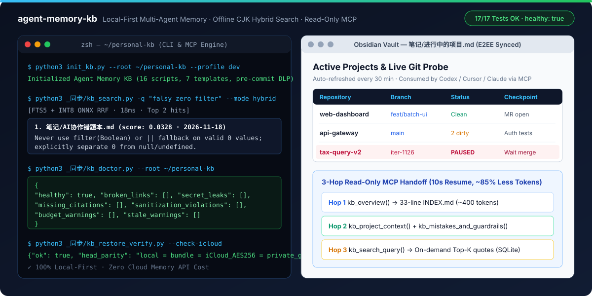
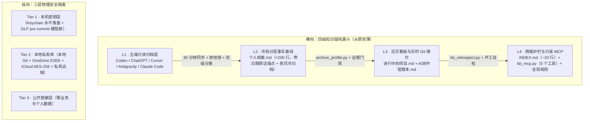

# agent-memory-kb（AI 原生个人知识库与跨端共享记忆引擎）

[](https://github.com/JaydenWuGang123/agent-memory-kb/actions/workflows/ci.yml)
[](LICENSE)
[](https://www.python.org/)
[](#为什么做-agent-memory-kb)

[English README](README.md) · [架构与原理深度解析](docs/architecture.md) · [完整 API / 配置 / 脚本手册](docs/reference.md) · [团队落地与 FAQ](docs/team-and-faq.md)

面向重度使用多个 AI 编程助手的开发者（**Codex / Claude Code / Cursor / Antigravity / ChatGPT**）的**本地优先（Local-First）、Git 驱动、自带离线混合检索 MCP + 错题本自进化 + 工业级防漏容灾**知识库引擎。

> **核心理念**：*AI 时代的知识库，第一读者不是人，而是你的 Agent。*
> 零云端记忆 API 费用，100% 本地 Markdown + SQLite FTS5 中文混合检索 + 离线 INT8 ONNX 语义向量 + 错题本自动复盘 + DLP 防泄密与四端加密容灾。



---

## 为什么做 `agent-memory-kb`？

| 对比维度 | 传统笔记 / 手动贴提示词 | `agent-memory-kb`（Agent-First） |
| --- | --- | --- |
| **知识沉淀** | 人工复制粘贴，极度打断写代码心流，2 周弃坑 | 后台每 30 分钟只读增量归档五端对话，零手动负担 |
| **跨工具接力** | 每次切窗口人工重建背景 5~15 分钟 | **~10 秒**：Agent 读 30 行 `INDEX.md` ➔ 带实时 Git 探针的项目活页 |
| **Token 开销** | 整篇贴历史 / 全量塞规范（~1.2w–2.5w Tokens） | **~3,000 Tokens**：3 跳渐进披露 + 本地 SQLite 精准召回 Top-K |
| **防重犯机制** | 同类低级 Bug 跨会话反复消耗 CR 与联调工时 | 自动识别多轮纠偏会话 ➔ 归并 `[复发 xN]` 错题铁律，开工前自检 |
| **安全与容灾** | 闭源 SaaS 托管或无门禁本地目录 | 纯本地 Markdown + 钥匙串 AES-256 + DLP `pre-commit` + 四端哈希演练 |

---

## 谁适合用？（不只是程序员！）

只要你平时会用 **Codex / Claude Code / Cursor / Antigravity / ChatGPT** 干活，不管写不写代码，都能给你的 AI 装上同一个永久本地外脑：

| 使用角色 | 开箱即得的价值 |
| --- | --- |
| **研发工程师（前端 / 后端 / 独立开发）** | 多仓库实时 Git 探针、10 秒跨工具接力、代码/联调错题本自动防重犯（`--profile dev`） |
| **产品经理 / 运营 / 项目管理** | 自动存下每次需求讨论与竞品调研，沉淀已确认口径，换窗口不再重讲业务背景（`--profile general`） |
| **自媒体 / 内容创作者 / 一人公司** | 自动归档灵感、选题与脚本打磨过程，让 Codex 记住你的表达风格与避坑偏好（`--profile general`） |
| **学习 / 读书 / 个人规划与理财** | 跨月追踪学习进度与长期原则，毫秒级翻出三个月前自己定下的纪律（`--profile general`） |

---

## 5 分钟快速上手

### 方式 A：一句话让 Codex 替你全自动装好（不会敲命令直接用这个！）

根本不用自己打开终端敲命令、改 JSON，**直接把下面这句话发给你的 Codex / Claude Code / Antigravity**：

```text
请帮我克隆 https://github.com/JaydenWuGang123/agent-memory-kb 并初始化到 ~/personal-kb（如果我不是程序员请加 --profile general，否则用 --profile dev）。按项目说明帮我完成首次同步、kb_doctor 健康体检、只读 MCP 接入和全局规则配置，全程用大白话告诉我结果；涉及可选云备份配置时先问我再操作。
```

### 方式 B：手动命令行初始化（仅需 Python 3.9+ 标准库）

```bash
git clone https://github.com/JaydenWuGang123/agent-memory-kb.git
cd agent-memory-kb

# 研发模式（默认，含活跃代码仓库 Git 探针）：
python3 init_kb.py --root ~/personal-kb --profile dev

# 通用非研发模式（PM / 创作者 / 个人规划，含目标看板与表达偏好避坑本）：
python3 init_kb.py --root ~/personal-kb --profile general
```

### 2. 运行首次同步、健康体检与中文秒查

```bash
python3 ~/personal-kb/_同步/build_kb_index.py --output-root ~/personal-kb --skip-icloud
python3 ~/personal-kb/_同步/kb_doctor.py --root ~/personal-kb
python3 ~/personal-kb/_同步/kb_search.py --root ~/personal-kb -q "关键词或报错" --mode fts
```

### 3. 接入只读 MCP Server 与离线语义向量（可选）

```bash
pip install -r requirements.txt
```

参照 [`examples/mcp_config.example.json`](examples/mcp_config.example.json) 将 `~/personal-kb/_同步/kb_mcp.py` 注册进 **Codex / Cursor / Claude Code / Antigravity**，并将 [`examples/agent-rules.md`](examples/agent-rules.md) 放入全局 Agent 规则（`AGENTS.md` / `CLAUDE.md` / `GEMINI.md`）。

在 macOS 或 Linux 上，从需要接入的项目目录运行下面的命令。请使用已安装 MCP 依赖的 Python 解释器，然后在 Claude Code 中用 `/mcp` 检查连接，让 Claude 调用 `kb_overview` 核对知识库。

```sh
claude mcp add --scope local --transport stdio personal-kb -- python3 "$HOME/personal-kb/_同步/kb_mcp.py"
```


### 4. 开启跨平台定时同步（macOS / Linux / Windows）与手机端加密同步（可选）

- **macOS（`launchd` + 钥匙串 AES-256 iCloud 容灾）**：[`examples/personal-kb-sync.sh.example`](examples/personal-kb-sync.sh.example) 与 [`examples/launchd.personal-kb-sync.plist.example`](examples/launchd.personal-kb-sync.plist.example)。
- **Linux（`systemd` 用户定时器）**：[`examples/linux-systemd/agent-memory-kb.service`](examples/linux-systemd/agent-memory-kb.service) 与 [`examples/linux-systemd/agent-memory-kb.timer`](examples/linux-systemd/agent-memory-kb.timer)。
- **Windows（PowerShell + 任务计划程序）**：[`examples/windows-sync.ps1`](examples/windows-sync.ps1)。
- **免费手机端端到端加密同步**：用 Obsidian 打开 `~/personal-kb`，按 [`templates/跨设备配置.md`](templates/跨设备配置.md) 配置 Remotely Save（OneDrive 应用目录 + RClone Crypt）。

---

## 全景架构一览



---

## 核心能力亮点

- **五端零摩擦采集**：只读增量导出 Codex / Cursor / Antigravity / Claude Code / ChatGPT，`fcntl.flock` 防并发 + 180s 超时隔离 + 双级自动分类。
- **离线中文混合检索**：SQLite FTS5（中文单字分词 + 同义词扩展）+ 本地 CPU **INT8 ONNX** 语义向量 + **RRF 融合重排**，零云端 API 费用。
- **跨端原生只读 MCP**：一次封装暴露 5 个原子工具（`kb_overview`、`kb_project_context`、`kb_mistakes_and_guardrails`、`kb_search_query`、`kb_read_note`），自带严格路径穿越防护。
- **错题本自进化闭环**：自动嗅探多轮纠偏会话，去重沉淀 `[复发 xN]` 铁律，开工前自动自检。
- **工业级防漏与四端容灾**：`kb_doctor.py` + `pre-commit` 硬拦截密钥、死链、缺引用与预算超标；`kb_restore_verify.py` 定期演练核对四端 Git `HEAD` 哈希一致。

---

## 深度专题文档导航

| 文档 | 内容涵盖 |
| --- | --- |
| [**架构与核心机制深度解析**](docs/architecture.md) | 跨 Agent 接力时序图、3 跳 Token 经济账、CJK FTS5 + RRF 混合检索原理、防幻觉证据链、DLP v2 与四端容灾机制 |
| [**完整参考手册**](docs/reference.md) | 初始化目录结构全景、5 个 MCP 工具精确 API 参数表、16 个脚本速查表、`kb_config.json` 全字段参考、日常 CLI 命令速查 |
| [**团队落地与 FAQ**](docs/team-and-faq.md) | 企业内网 GitLab 100% 闭环指南、SSOT 个人/团队规范隔离、3 阶段低风险推广路线图、8 个高频常见问题 |

---

## 运行单元测试

```bash
PERSONAL_KB_SKIP_KEYCHAIN=1 python3 -m unittest discover -s scripts -p 'test_*.py' -v
```

GitHub Actions 在 Ubuntu 和 Windows 上使用 Python 3.11 和 3.12 运行整套回归测试。

## 开源协议

[MIT](LICENSE) — 欢迎 Star、提 Issue 或 PR！
