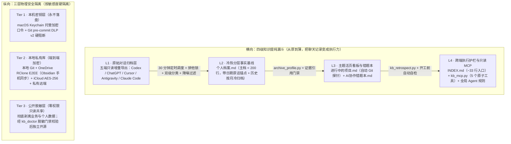
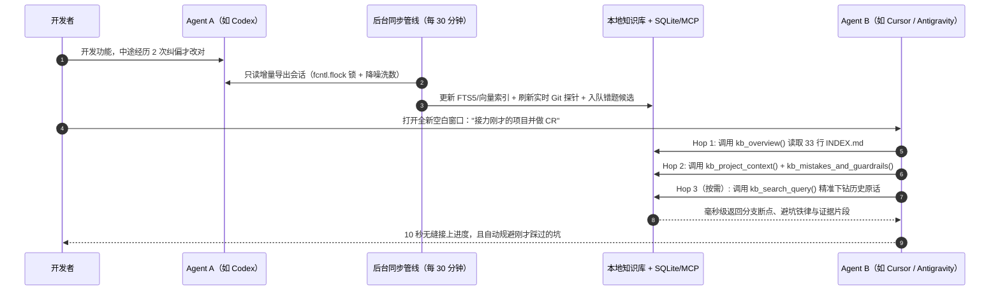

# agent-memory-kb（AI 原生个人知识库与跨端共享记忆引擎）

[](https://github.com/JaydenWuGang123/agent-memory-kb/actions/workflows/ci.yml)
[](LICENSE)
[](https://www.python.org/)
[](#为什么做-agent-memory-kb)

[English Documentation (README.md)](README.md)

面向重度使用多个 AI 编程助手的开发者（**Codex / Claude Code / Cursor / Antigravity / ChatGPT**）的**本地优先（Local-First）、Git 驱动、自带离线混合检索 MCP Server + 错题本自进化 + 工业级防泄密与四端容灾**的 AI 原生知识库引擎。

> **核心理念**：*AI 时代的知识库，第一读者不是人，而是你的 Agent。*
> 传统笔记软件追求“人工分类、精美排版”，工程师写完代码根本坚持不下去，最后变成“只收藏不回看”的垃圾场；而 `agent-memory-kb` 是一套**面向 Agent 的本地上下文工程（Context Engineering）基础设施**——后台零手动归档五端对话、自动探测本机 Git 项目断点、自动提炼多轮纠错错题本，并通过 **3 跳渐进式披露 + 本地离线混合检索 + 标准只读 MCP**，让任意 AI 编程工具在 10 秒内无缝接力上下文并主动规避历史踩坑。

---

## 目录

1. [为什么做 `agent-memory-kb`？（真实痛点）](#1-为什么做-agent-memory-kb真实痛点)
2. [使用前后对比](#2-使用前后对比)
3. [全景架构与跨工具接力时序](#3-全景架构与跨工具接力时序)
4. [核心机制深度解析](#4-核心机制深度解析)
   - [4.1 五端只读异构采集与双级分类](#41-五端只读异构采集与双级分类)
   - [4.2 三跳渐进式披露与 Token 经济账](#42-三跳渐进式披露与-token-经济账)
   - [4.3 离线中文混合检索引擎（FTS5 + ONNX + RRF）](#43-离线中文混合检索引擎fts5--onnx--rrf)
   - [4.4 标准只读 MCP Server 工具参考（5 个原子工具）](#44-标准只读-mcp-server-工具参考5-个原子工具)
   - [4.5 防幻觉证据链与按月冷归档](#45-防幻觉证据链与按月冷归档)
   - [4.6 AI 协作错题本自进化闭环](#46-ai-协作错题本自进化闭环)
   - [4.7 工业级 DLP v2 门禁、7 维体检与四端容灾](#47-工业级-dlp-v2-门禁7-维体检与四端容灾)
5. [初始化后的知识库目录结构](#5-初始化后的知识库目录结构)
6. [16 个核心脚本速查表](#6-16-个核心脚本速查表)
7. [`kb_config.json` 完整配置参考](#7-kb_configjson-完整配置参考)
8. [5 分钟从零到生产级部署指南](#8-5-分钟从零到生产级部署指南)
9. [日常高频命令速查（CLI Cheat Sheet）](#9-日常高频命令速查cli-cheat-sheet)
10. [团队落地与企业内网合规指南](#10-团队落地与企业内网合规指南)
11. [运行自动化测试](#11-运行自动化测试)
12. [常见问题（FAQ）](#12-常见问题faq)
13. [开源协议](#13-开源协议)

---

## 1. 为什么做 `agent-memory-kb`？（真实痛点）

当你同时在 **Codex、Cursor、Claude Code、Antigravity、ChatGPT** 之间高频切换写业务代码和设计文档时，几乎必然遇到 4 个结构性瓶颈：

1. **跨会话失忆与上下文割裂（Context Fragmentation）**
   几百条对话、上万条消息散落在 5 个工具各自的本地数据库或网页里，像一座「聊天记录坟场」。换一个工具窗口就要花 5~15 分钟重新交代仓库分支、需求边界和历史决定。
2. **上下文腐化与 Token 浪费（Context Rot & Quota Burn）**
   为了不让 AI 忘事，把大段历史记录和几十条规则直接贴进提示词，结果起手就吃掉 1~2 万 Token，既疯狂消耗订阅额度，又导致模型注意力分散。
3. **同类低级 Bug 反复返工（Rework Tax）**
   今天在 Codex 里纠了 3 轮才改对的坑（例如合法零值 `0` 被 `Boolean` 吞掉、相近接口字段被猜错映射、Mock 跑通误写成真实联调通过），明天在 Cursor 里开个新窗口，AI 又按默认惯性重犯一遍。
4. **隐私、规范与备份风险（Privacy & Governance Gap）**
   闭源云端记忆 API 要求把私有代码上下文上传第三方服务器，企业研发根本不敢用；自己建本地笔记又怕误提交密钥、误改团队公共规范，或者电脑坏了丢掉半年沉淀。

---

## 2. 使用前后对比

| 对比维度 | 传统笔记 / 手动贴提示词 | `agent-memory-kb`（Agent-First） |
| --- | --- | --- |
| **知识采集方式** | 人工复制粘贴、手动打标签，极度打断写代码心流，2 周弃坑 | 后台 `launchd` 每 30 分钟只读增量归档五端对话，零手动负担 |
| **跨工具接力耗时** | 每次切窗口人工重建背景 5~15 分钟 | **~10 秒**：Agent 读取 30 行 `INDEX.md` ➔ 自动 Git 探针项目活页 |
| **初始 Token 开销** | 整篇贴历史 / 全量规则注入（~12,000–25,000 Tokens） | **~3,000 Tokens**（3 跳渐进披露 + 本地 SQLite Top-K 精准召回） |
| **事实与幻觉控制** | 猜测、Mock 验证、真实联调混为一谈，误导下游会话 | 强制**原话证据锚点**（日期 + 来源）+ 明确验证边界 + 按月冷归档 |
| **防重犯机制** | 同类低级问题跨会话反复消耗 CR 与联调工时 | 自动嗅探多轮纠偏会话 ➔ 去重归并 `[复发 xN]` 错题铁律，开工前自检 |
| **安全与容灾能力** | 闭源 SaaS 托管或无门禁本地目录 | 100% 本地纯文本 + 钥匙串 AES-256 + DLP `pre-commit` 硬阻断 + 四端哈希演练 |

---

## 3. 全景架构与跨工具接力时序

### 3.1 四级知识漏斗 × 三层安全隔离



### 3.2 跨 Agent 无缝接力与防重犯时序



---

## 4. 核心机制深度解析

### 4.1 五端只读异构采集与双级分类
- **严格只读适配**：`export_codex.py`、`export_cursor.py`、`export_antigravity.py`、`export_claude.py`、`export_chatgpt.py` 仅以只读模式读取各工具的本地 SQLite / JSONL / 导出文件，绝不锁表、不侵入原工具状态。
- **高可靠调度保护**：
  - `fcntl.flock` 进程排他锁防止多实例并发写坏仓库；
  - 单个导出器内置 **180 秒超时熔断**，一端异常绝不阻塞其余 4 端；
  - 自动过滤 AI 内部的 `thinking` 思考块、超长 `tool_call` 输出、空会话和无意义打招呼（可在 `kb_config.json` 的 `noise_filter` 自定义正则）。
- **双级自动分类**：优先匹配标题语义关键词（`title_categories`），未命中再用工作区路径（`cwd_categories`）兜底，大幅压低“其他与待整理”噪音比例。
- **内容变化才提交**：幂等检查工作区差异，无实质变更绝不产生空 Git Commit。

### 4.2 三跳渐进式披露与 Token 经济账
- **Hop 1（~400 Tokens）**：`INDEX.md` 仅 30 余行，只做目录导航，不做正文堆砌。
- **Hop 2（~1,100 Tokens）**：按任务加载对应活页（如 `笔记/进行中的项目.md` 或 `笔记/AI协作错题本.md`），80% 日常任务到此即可开工。
- **Hop 3（~1,500 Tokens，按需）**：遇到具体历史决策、旧报错或接口争议时，再调用混合检索精准召回 Top-K 原话片段。
- 把几万条消息的检索计算留在本地 SQLite，不塞进模型上下文窗口，单会话初始上下文开销相比传统整篇粘贴降低约 **85%**。

### 4.3 离线中文混合检索引擎（FTS5 + ONNX + RRF）
标准 SQLite FTS5 默认分词器对中文几乎无效，本项目零外部向量数据库、零云端 Embedding API 费用，采用双路融合设计：
1. **词法检索路（`fts`）**：基于 SQLite FTS5（`contentless_delete=1`）实现**中文单字分词 + 英文词组/标识符保留** + 同义词扩展（`synonyms`）+ 多关键词 `AND` + 长自然语言问句软挽救，精准命中报错码、函数名、字段名。
2. **语义检索路（`semantic`）**：`kb_embed.py` 使用本地轻量 **INT8 ONNX** 多语种模型在 CPU 上计算向量，并按内容哈希做增量缓存，解决“记得大概意思但忘了原词”的查询。
3. **RRF 混合重排（`hybrid`）**：通过倒数排名融合公式 $\text{score} = \sum \frac{1}{k + \text{rank}}$ 融合两路召回结果，同时设置单会话返回条数上限（`per_conv`）防刷屏，并按 `updated_at` 优先展示最新记录。

### 4.4 标准只读 MCP Server 工具参考（5 个原子工具）

`scripts/kb_mcp.py` 遵循标准 MCP 协议，所有工具均为**严格只读**且绑定环境变量 `AGENT_MEMORY_KB_ROOT`（默认 `~/personal-kb`）：

| 工具名 | 参数与默认值 | 返回内容与用途 | 安全约束 |
| --- | --- | --- | --- |
| `kb_overview()` | 无参数 | 返回 `INDEX.md` 全文、活页目录清单、SQLite 索引统计信息 | 只读 |
| `kb_project_context(cwd_or_project)` | `cwd_or_project: str`（项目名或路径片段） | 精准提取 `笔记/进行中的项目.md` 中匹配的活跃项目断点与实时 Git 探针状态 | 只读 |
| `kb_mistakes_and_guardrails(include_pending=True)` | `include_pending: bool = True` | 返回 `笔记/AI协作错题本.md` 顶层防重犯铁律，以及可选的待复盘高摩擦会话队列 | 只读 |
| `kb_search_query(query, mode="hybrid", source="all", limit=8)` | `query: str`, `mode: "fts"\|"semantic"\|"hybrid"`, `source: "all"\|"notes"\|"codex"\|...`, `limit: int` | 调用双路检索引擎返回带文件路径、日期、来源和命中上下文片段的 JSON | 只读 |
| `kb_read_note(rel_path, start_line=1, max_lines=160)` | `rel_path: str`, `start_line: int = 1`, `max_lines: int = 160` | 分页读取知识库内指定 Markdown 文件的受控行段 | **强制路径穿越校验**，禁止读取库根目录外的任何文件 |

### 4.5 防幻觉证据链与按月冷归档
- **事实与建议分离**：只提炼用户明确确认的原话写入 `个人档案.md`，并强制要求附带日期与对话锚点；AI 建议绝不自动升级为事实。
- **显式验证边界**：要求明确区分「用户口头确认」「Mock 跑通」与「真实后端联调通过」，避免后续会话基于虚假前提继续叠代码。
- **冷热分层（`archive_profile.py`）**：当主档案超过 `profile_auto_archive_lines`（默认 260 行）时，自动将历史月份流水冷归档至 `笔记/历史档案/` 并自动重写相对 Markdown 链接，确保主档永远精炼不腐化。

### 4.6 AI 协作错题本自进化闭环
- `kb_retrospect.py scan` 自动扫描近期归档对话，识别出现多轮用户纠偏/打断的高摩擦会话，并写入 `_同步/retrospect-queue.json` 和 `笔记/AI协作错题本.md` 的待处理区。
- 复盘提炼时，将同类根因合并并递增 `[复发 xN]` 权重；处理完毕后运行 `kb_retrospect.py resolve --path "<相对路径>"` 标记消化。
- 每次新会话开工前，Agent 通过 `kb_mistakes_and_guardrails` 自动加载顶层铁律，实现「踩过一次坑，四端永久免疫」。

### 4.7 工业级 DLP v2 门禁、7 维体检与四端容灾
- **DLP v2 防泄密（`kb_filters.py`）**：绑定 `.git/hooks/pre-commit`，提交前自动拦截：
  - JWT Token、Bearer 凭证、Cookie 头；
  - 数据库连接串密码（DSN）、`.env` 敏感键值；
  - 身份证号、私钥块、上下文高熵随机密钥；
  - 公开目录中的自定义脱敏黑名单（`sanitization_extra_patterns`）。
- **7 维健康体检（`kb_doctor.py`）**：一键检查死链、缺失来源引用、活页行数预算、DLP 密钥泄露、公开目录脱敏违规、配置路径漂移、以及超过 `staleness_warn_days`（默认 14 天）未更新的陈旧项目。
- **四端容灾与自动演练（`kb_backup.py` + `kb_restore_verify.py`）**：
  1. 本地 Git 仓库（含松散对象自动 `git gc`）；
  2. 本地原子校验 `git bundle`；
  3. macOS 钥匙串 **AES-256 加密 iCloud Drive 镜像**（含写入后解密回环校验，遇 iCloud 占用异常自动清理孤儿 `.tmp.*` 不崩溃）；
  4. 私有 Git 远端推送（内置反误推门禁：若远端 URL 含 `public` 字样直接拒绝推送私有库）；
  5. `kb_restore_verify.py` 定期在独立临时目录执行完整解密克隆演练，核对四端 `HEAD` 提交哈希 100% 一致。

---

## 5. 初始化后的知识库目录结构

运行 `python3 init_kb.py --root ~/personal-kb` 后，你的本地知识库目录结构如下：

```text
~/personal-kb/
├── INDEX.md                       # 第 1 跳入口（~30 行）：所有 Agent 的统一导航地图
├── 个人档案.md                     # L2 热事实基线（带日期与来源锚点，超预算自动冷归档）
├── 对话索引.md                     # 五端归档对话总目录（自动按分类与时间生成）
├── 跨设备配置.md                   # Obsidian + Remotely Save (OneDrive E2EE) 同步配置指南
├── 笔记/
│   ├── 进行中的项目.md             # L3 活看板：顶部自动注入本机活跃 Git 仓库实时探针
│   ├── AI协作错题本.md             # L3/L4 防重犯护栏：顶层铁律 + [复发 xN] 错题归档
│   ├── 知识库架构与治理.md         # 治理规范、预算红线与维护说明
│   └── 历史档案/                   # archive_profile.py 按月自动迁入的冷历史
├── 对话/                           # L1 五端只读归档原始 Markdown（按工具分子目录）
│   ├── Codex/
│   ├── Cursor/
│   ├── Antigravity/
│   ├── ClaudeCode/
│   └── ChatGPT/
├── 共享摘录/                       # Tier 3 公开脱敏区（受 kb_doctor 脱敏红线强制扫描）
└── _同步/                          # 全部 16 个自动化脚本、SQLite 检索库与状态文件
    ├── kb_config.json             # 唯一用户配置文件
    ├── kb_search.sqlite           # SQLite FTS5 + 向量本地索引（已加入 .gitignore）
    ├── 同步报告.md                 # 每次同步的增量统计、导出报错与缺口透明报告
    └── *.py                       # 16 个核心脚本
```

---

## 6. 16 个核心脚本速查表

| 脚本路径 | 核心职责 | 运行依赖 |
| --- | --- | --- |
| `init_kb.py` | 一键初始化目录、模板、配置、Git 仓库与防泄密 `pre-commit` 钩子 | Python 3.9+ 标准库 |
| `scripts/export_codex.py` | 只读增量导出本机 Codex 会话 | Python 标准库 |
| `scripts/export_cursor.py` | 只读增量导出 Cursor 本地工作区 SQLite 对话 | Python 标准库 |
| `scripts/export_antigravity.py` | 只读增量导出 Antigravity 会话日志 | Python 标准库 |
| `scripts/export_claude.py` | 只读增量导出 Claude Code 会话（剔除 thinking / tool 噪声） | Python 标准库 |
| `scripts/export_chatgpt.py` | 增量导入并规范化 ChatGPT 导出对话 | Python 标准库 |
| `scripts/build_kb_index.py` | 总编排管线：排他锁、180s 超时隔离、双级分类、实时 Git 探针、FTS5 建库、幂等提交 | Python 标准库 |
| `scripts/kb_search.py` | CLI 与库：`fts` / `semantic` / `hybrid`（RRF）多模式检索 | 标准库（`fts`）；可选 ONNX |
| `scripts/kb_embed.py` | 本地离线 INT8 ONNX 语义向量生成与内容哈希增量缓存 | 可选（`requirements.txt`） |
| `scripts/kb_mcp.py` | 标准只读 MCP Server，向多端 Agent 暴露 5 个原子工具 | 可选（`mcp`） |
| `scripts/kb_retrospect.py` | 嗅探多轮纠偏高摩擦会话，管理错题本候选队列与状态流转 | Python 标准库 |
| `scripts/archive_profile.py` | `个人档案.md` 按月冷归档并自动重写相对链接 | Python 标准库 |
| `scripts/kb_filters.py` | DLP v2 凭证打码、噪声过滤、脱敏黑名单规则引擎 | Python 标准库 |
| `scripts/kb_doctor.py` | 7 维自动化健康体检门禁（输出结构化 JSON） | Python 标准库 |
| `scripts/kb_backup.py` | 原子 `git bundle` + 钥匙串 AES-256 iCloud 镜像 + 私有远端推送 | 标准库 + `openssl` |
| `scripts/kb_restore_verify.py` | 独立临时目录解密恢复演练，核对四端 Git `HEAD` 哈希一致 | 标准库 + `openssl` |
| `scripts/test_kb_pipeline.py` | 16 项全链路自动化回归单元测试 | Python 标准库 |

---

## 7. `kb_config.json` 完整配置参考

初始化后编辑 `~/personal-kb/_同步/kb_config.json` 即可完全定制你的知识库行为（无需改脚本源码）：

```json
{
  "active_repos": [
    {"name": "my-frontend-app", "path": "/Users/you/workspace/my-frontend-app"},
    {"name": "my-backend-api", "path": "/Users/you/workspace/my-backend-api"}
  ],
  "cwd_categories": [
    ["工程与工作项目", "/work/|/projects/|frontend|backend"],
    ["产品与个人项目", "side-project|indie|personal-project"],
    ["学习与成长", "learning|study|agent-memory-kb"]
  ],
  "title_categories": [
    ["工程与工作项目", "前端|后端|设计文档|接口|组件|React|Vue|TypeScript|Python|bug|修复|重构|CI"],
    ["工具与效率", "Codex|ChatGPT|Claude|Cursor|Antigravity|Skill|MCP|Obsidian|自动化"]
  ],
  "synonyms": [
    ["个人知识库", "PKM", "知识库"],
    ["容灾", "灾备", "备份"]
  ],
  "sanitization_extra_patterns": [],
  "extra_public_dirs": [],
  "git_gc_loose_threshold": 300,
  "icloud_lag_warn_hours": 4,
  "restore_verify_interval_hours": 24,
  "profile_auto_archive_lines": 260,
  "staleness_warn_days": 14,
  "macos_notify_on_error": true,
  "alert_cooldown_hours": 12,
  "private_git_remote": "private-backup",
  "noise_filter": {
    "drop_zero_message": true,
    "probe_title_regex": "^Reply (?:with )?exactly (?:[A-Z0-9_]+_)?OK\\b",
    "trivial_user_regex": "^(?:你好|您好|hi|hello)[!！?？。.,，\\s]*$",
    "excluded_ids": []
  }
}
```

| 关键配置项 | 含义与默认值 |
| --- | --- |
| `active_repos` | 需要实时 Git 探针自动监控的本机仓库列表（`name` + `path`），结果自动刷新到 `笔记/进行中的项目.md` 顶部 |
| `title_categories` / `cwd_categories` | 双级分类规则：先按对话标题正则匹配，再按工作区路径兜底 |
| `synonyms` | 检索同义词组，查其中一个词时自动扩展命中同组词 |
| `sanitization_extra_patterns` | 额外禁止出现在公开目录（如 `共享摘录/`）的正则表达式（例如公司内部域名特征） |
| `profile_auto_archive_lines` | `个人档案.md` 触发自动冷归档的行数阈值（默认 `260`） |
| `staleness_warn_days` | 项目活页超过多少天未更新触发陈旧度告警（默认 `14`） |
| `private_git_remote` | 私有备份 Git 远端名（如 `private-backup`），设为 `null` 则仅做本地备份 |
| `noise_filter` | 自动剔除 0 消息会话、健康探测会话、纯打招呼会话或指定 `excluded_ids` |

---

## 8. 5 分钟从零到生产级部署指南

### 第 1 步：克隆并一键初始化

```bash
git clone https://github.com/JaydenWuGang123/agent-memory-kb.git
cd agent-memory-kb

# 在 ~/personal-kb（或任意自定义路径）生成独立本地知识库
python3 init_kb.py --root ~/personal-kb
```

### 第 2 步：首次运行同步、体检与检索（仅依赖 Python 标准库）

```bash
# 1. 运行首次采集、索引与 Git 快照
python3 ~/personal-kb/_同步/build_kb_index.py --output-root ~/personal-kb --skip-icloud

# 2. 运行 7 维健康体检
python3 ~/personal-kb/_同步/kb_doctor.py --root ~/personal-kb

# 3. 测试中文 FTS5 秒查
python3 ~/personal-kb/_同步/kb_search.py --root ~/personal-kb -q "关键词或报错" --mode fts
```

健康通过时 `kb_doctor.py` 返回：
```json
{
  "healthy": true,
  "broken_links": [],
  "missing_citations": [],
  "budget_warnings": [],
  "sanitization_violations": [],
  "config_errors": [],
  "secret_leaks": [],
  "stale_warnings": []
}
```

### 第 3 步：接入 MCP Server 与本地语义向量（可选，强烈推荐）

```bash
pip install -r requirements.txt
```

在 **Codex / Cursor / Claude Code / Antigravity** 的 MCP 配置文件中加入（详见 [`examples/mcp_config.example.json`](examples/mcp_config.example.json)）：

```json
{
  "mcpServers": {
    "personal-kb": {
      "command": "/usr/local/bin/python3",
      "args": ["/Users/YOUR_NAME/personal-kb/_同步/kb_mcp.py"],
      "env": {
        "AGENT_MEMORY_KB_ROOT": "/Users/YOUR_NAME/personal-kb"
      }
    }
  }
}
```

然后将 [`examples/agent-rules.md`](examples/agent-rules.md) 复制到你的全局 Agent 规则文件（`AGENTS.md` / `CLAUDE.md` / `GEMINI.md`）中，即可让所有工具开机自动遵循 3 跳披露与错题自检协议。

### 第 4 步：开启每 30 分钟后台自动同步与加密容灾（macOS）

1. 复制 [`examples/personal-kb-sync.sh.example`](examples/personal-kb-sync.sh.example) 到 `~/.local/bin/personal-kb-sync.sh` 并执行 `chmod +x ~/.local/bin/personal-kb-sync.sh`。
2. 在 macOS 钥匙串存入加密口令（绝不落盘明文）：
   ```bash
   security add-generic-password -U -a "$USER" -s "agent-memory-kb.icloud-bundle" -w
   ```
3. 按 [`examples/launchd.personal-kb-sync.plist.example`](examples/launchd.personal-kb-sync.plist.example) 安装并加载 `launchd` 定时任务：
   ```bash
   launchctl bootstrap gui/$(id -u) ~/Library/LaunchAgents/local.personal-kb-sync.plist
   ```
   *(若后台需要写入 iCloud Drive，请在 macOS「系统设置 → 隐私与安全性 → 完全磁盘访问权限」授权 `/bin/zsh`。)*

### 第 5 步：免费手机端端到端加密同步（Obsidian + OneDrive）

直接用 Obsidian 打开 `~/personal-kb` 作为 Vault，参照 [`templates/跨设备配置.md`](templates/跨设备配置.md) 配置社区插件 **Remotely Save**（OneDrive 应用目录 + **RClone Crypt 端到端加密**），即可零成本在 Mac / iPhone / Android / Windows 间安全同步，云端仅存密文乱码。

---

## 9. 日常高频命令速查（CLI Cheat Sheet）

```bash
# 混合检索（FTS5 + 本地向量 RRF，JSON 输出）
python3 ~/personal-kb/_同步/kb_search.py --root ~/personal-kb -q "接口字段 映射" --mode hybrid --json

# 仅检索精选笔记，限定返回 5 条
python3 ~/personal-kb/_同步/kb_search.py --root ~/personal-kb -q "容灾" --source notes --limit 5

# 扫描近期多轮纠偏高摩擦会话（错题本候选）
python3 ~/personal-kb/_同步/kb_retrospect.py --root ~/personal-kb scan

# 标记某条错题候选已消化沉淀
python3 ~/personal-kb/_同步/kb_retrospect.py --root ~/personal-kb resolve --path "对话/Codex/xxx.md"

# 执行四端容灾恢复演练（含 iCloud 密文解密校验）
python3 ~/personal-kb/_同步/kb_restore_verify.py --root ~/personal-kb --check-icloud

# 严格模式健康体检（含陈旧度检查）
python3 ~/personal-kb/_同步/kb_doctor.py --root ~/personal-kb --strict-staleness
```

---

## 10. 团队落地与企业内网合规指南

这套架构不仅适合个人开发者，也非常适合研发团队低成本、高合规地渐进式落地：

1. **100% 内网闭环**：将 `private_git_remote` 指向公司内部私有 GitLab 仓库，即可完全脱离公网云服务，零外部 SaaS 采购成本。
2. **个人规范与团队规范严格隔离（SSOT）**：团队公共代码规范保持只读最高优先级；个人踩坑先在本地个人错题本高频试错，经多需求验证且 `[复发 xN]` 较高的共性真问题，再通过团队评审（MR）晋升为团队公共规范或团队只读 MCP 资产。
3. **3 阶段低风险推广**：
   - **第 1 周**：个人 30 分钟自愿试点，跑通项目断点与错题本；
   - **第 1 个月**：迭代复盘共创团队高频避坑清单，压低同类 CR 返工；
   - **第 1 季度**：沉淀团队只读 MCP 知识底座，加速新人 1 天上手。

---

## 11. 运行自动化测试

```bash
PERSONAL_KB_SKIP_KEYCHAIN=1 python3 -m unittest discover -s scripts -p 'test_*.py' -v
```

16 项自动化回归测试完整覆盖五端导出、CJK FTS5 与 RRF 混合检索、MCP Server、DLP v2 门禁、冷归档自动重写链接、错题本状态机与 iCloud 权限冲突容灾，约 7 秒完成，并由 GitHub Actions 在 Python 3.11 / 3.12 矩阵上持续验证。

---

## 12. 常见问题（FAQ）

- **Q1：会把我的公司代码或隐私上传到第三方云端吗？**
  不会。所有 Markdown、Git 历史、SQLite 索引和 ONNX 向量 100% 留在你本机；备份与同步目标完全由你自己控制（如私有 GitLab/GitHub、AES-256 加密包或 E2EE OneDrive）。
- **Q2：可以在公司内网配合 GitLab 使用吗？**
  完全可以，无任何公网强制依赖。
- **Q3：离线语义向量检索需要 GPU 吗？需要调 OpenAI API 吗？**
  都不需要。`kb_embed.py` 在普通 CPU 上本地运行 INT8 ONNX 模型并带增量缓存；如果不想装任何第三方包，使用 `--mode fts` 纯 Python 标准库也能毫秒级精准检索。
- **Q4：导出脚本会破坏或锁死 Codex / Cursor / Claude 的原始数据吗？**
  不会。所有导出器均严格只读访问源数据，且带 180 秒单端超时熔断，绝不影响原工具正常运行。
- **Q5：用一年后知识库会不会越来越胖、检索变慢？**
  不会。SQLite FTS5 支持数万条消息毫秒级检索；`kb_doctor.py` 严控热档案行数预算，`archive_profile.py` 按月自动冷归档旧记录并自动修复相对链接。
- **Q6：支持 Windows 或 Linux 吗？**
  核心 Python 脚本（初始化、检索、体检、MCP、单测、Git 快照）均跨平台支持 macOS / Linux / Windows；仅 Keychain 加密与 `launchd` 定时任务为 macOS 专属，Linux/Windows 可直接替换为 `systemd` / 任务计划程序 + 环境变量口令。
- **Q7：为什么强调「证据锚点」和「事实与建议分离」？**
  因为如果 AI 把“Mock 通过”或“自己的推测”记成“已联调通过”，下一个会话就会在错误前提上继续写代码，导致幻觉被二次放大。强证据链是长期可信的唯一解法。
- **Q8：不小心把测试密钥写进笔记了怎么办？**
  `.git/hooks/pre-commit` 会直接阻断提交并提示具体文件与命中规则；日常也可以随时跑 `kb_doctor.py` 全库扫描。

---

## 13. 开源协议

[MIT](LICENSE) — 欢迎 Star、Fork、提 Issue 或 PR，一起打磨更顺手的本地 AI 上下文工程基础设施！
