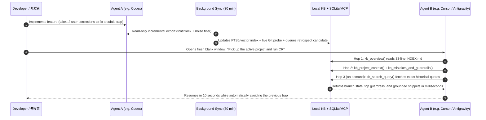

# Architecture & Core Mechanisms / 架构与核心机制深度解析

[← Back to README](../README.md) · [返回中文首页](../README.zh-CN.md)

This document explains how `agent-memory-kb` works under the hood: its **4-Stage Knowledge Distillation Funnel**, **3-Tier Physical Security Isolation**, **3-Hop Progressive Disclosure**, **Offline CJK Hybrid Search (FTS5 + INT8 ONNX + RRF)**, **Anti-Hallucination Evidence Chain**, **Self-Evolving Mistake Book**, and **4-Way Disaster Recovery**.

---

## 1. Multi-Agent Handoff & Self-Check Sequence（跨 Agent 接力时序）

---

## 2. 5-Source Read-Only Capture & Dual Classification（五端只读采集与双级分类）

- **Strictly Read-Only Adapters**: `export_codex.py`, `export_cursor.py`, `export_antigravity.py`, `export_claude.py`, and `export_chatgpt.py` read local SQLite/JSONL/export sources strictly read-only without locking or mutating any host database.
- **Production Reliability**:
  - `fcntl.flock` exclusive process lock prevents concurrent background runs from corrupting Git or SQLite;
  - Per-exporter **180-second timeout circuit breaker** ensures one slow source never blocks the other four;
  - Strips internal `thinking` blocks, huge `tool_call` dumps, empty sessions, and trivial greetings (`noise_filter` in `kb_config.json`).
- **Dual-Stage Classification**: Matches semantic keywords in conversation titles first (`title_categories`), then falls back to workspace path (`cwd_categories`), drastically shrinking uncategorized noise.
- **Idempotent Git Commits**: Only commits when meaningful file diffs exist — zero empty commits.

---

## 3. 3-Hop Progressive Disclosure & Token Economics（三跳渐进披露与 Token 经济账）

| Stage | Mechanism | Approx. Context Cost | Role |
| --- | --- | --- | --- |
| **Hop 1** | `kb_overview` / `INDEX.md` (~33 lines) | ~400 tokens | Lightweight routing map telling every agent where each category lives |
| **Hop 2** | `kb_project_context` / `kb_mistakes_and_guardrails` | ~1,100 tokens | Loads active project breakpoints (with live Git branch/dirty probe) and top guardrails; 80% of tasks start coding here |
| **Hop 3** | `kb_search_query` / `kb_read_note` (on demand) | ~1,500 tokens | Drills down into 20,000+ archived messages only when historical proof is needed |

Keeping retrieval inside local SQLite instead of pasting history into prompts cuts initial session context overhead by **~85%** (~3k vs. ~25k tokens) and keeps model attention sharp.

---

## 4. Offline CJK Hybrid Search Engine（离线中文混合检索引擎）

Standard SQLite FTS5 tokenizers perform poorly on Chinese/CJK text. `agent-memory-kb` fuses two 100% offline paths with zero cloud API fees:

1. **Lexical Path (`fts`)**: SQLite FTS5 (`content=''`) with **CJK unigram + Latin/identifier tokenization**, configurable synonym expansion (`synonyms`), multi-term `AND`, and natural-language query rescue — ideal for exact error codes, field names, and file paths.
2. **Semantic Path (`semantic`)**: `kb_embed.py` runs a lightweight local **INT8 ONNX** multilingual model on CPU with content-hash incremental caching — ideal when you remember the *meaning* but forgot the exact wording.
3. **Reciprocal Rank Fusion (`hybrid`)**: Merges both ranked lists via $\text{score} = \sum \frac{1}{k + \text{rank}}$, caps snippets per conversation (`per_conv`) to prevent spam, and prioritizes recent updates (`updated_at`).

---

## 5. Anti-Hallucination Evidence Chain & Cold Archiving（防幻觉证据链与冷归档）

- **Facts vs. Suggestions**: Only user-confirmed statements with dates and source anchors enter `个人档案.md`; AI suggestions never auto-promote to facts.
- **Explicit Verification Boundaries**: Distinguishes *user-confirmed rules*, *Mock-only verification*, and *real backend integration* so future sessions never stack code on false assumptions.
- **Monthly Cold Archiving (`archive_profile.py`)**: Once `个人档案.md` exceeds `profile_auto_archive_lines` (default 260), older monthly sections automatically archive into `笔记/历史档案/` while rebasing relative Markdown links cleanly.

---

## 6. Self-Evolving AI Mistake Book（AI 协作错题本自进化闭环）

1. `kb_retrospect.py scan` scans recent archived conversations for high-friction multi-correction sessions and queues them in `_同步/retrospect-queue.json` and `笔记/AI协作错题本.md`.
2. Recurring root causes are deduplicated and weighted with `[复发 xN]` counters.
3. Run `kb_retrospect.py resolve --path "<rel_path>"` once distilled.
4. Every new agent session loads the top guardrails via `kb_mistakes_and_guardrails` before editing code.

---

## 7. Industrial DLP v2, Health Gate & 4-Way Disaster Recovery（工业级安全与四端容灾）

- **DLP v2 (`kb_filters.py`)**: Bound to `.git/hooks/pre-commit`, blocking JWTs, Bearer tokens, Cookies, DB DSN passwords, `.env` keys, ID numbers, private key blocks, contextual high-entropy secrets, and custom `sanitization_extra_patterns`.
- **7-Dimension Health Doctor (`kb_doctor.py`)**: Audits broken links, missing citations, line budgets, secret leaks, public-dir sanitization violations, config integrity, and stale project notes (`staleness_warn_days`, default 14).
- **4-Way Disaster Recovery (`kb_backup.py` + `kb_restore_verify.py`)**:
  1. Local Git repository (with automatic `git gc`);
  2. Atomic local `git bundle`;
  3. macOS Keychain **AES-256 encrypted iCloud bundle** (with round-trip decrypt check & resilient orphan `.tmp.*` cleanup);
  4. Private Git remote (with an anti-public-URL safety gate rejecting remotes containing `public`);
  5. Isolated-directory restore drill verifying identical Git `HEAD` hashes across all 4 copies.

---

## 8. Optional Track 2: Dual-Track Multimodal RAG Extension（可选轨道 2：多模态深度 RAG 扩展）

While Track 1 (`agent-memory-kb`) stays 100% pure Python with zero Docker/GPU overhead for daily coding, complex PDFs (multi-column tables, formulas, scanned reports, Office decks) can optionally mount **Track 2**:
- **Recursive Parsed-Doc Indexing**: `kb_search.py` automatically indexes `资料/**/*.md`, so Markdown exported by local MinerU CLI immediately becomes searchable in Track 1.
- **On-Demand Zero-API-Cost Stack** ([`docs/optional-multimodal-rag.md`](optional-multimodal-rag.md) & [`extensions/weknora-rag/`](../extensions/weknora-rag/)): Combines local GPU **MinerU 4.2+** (`:8000`), local **Qwen/Qwen3-Embedding-0.6B** (`:8001`, 1024d / 32K), on-demand **WeKnora Docker** (`:8880`), DLP-redacted incremental sync (`kb_sync_weknora.py`), and a zero-dependency 4-client MCP stdio bridge (`weknora_mcp_bridge.py`) with physical separation between the long-term personal vault and temporary work documents.
