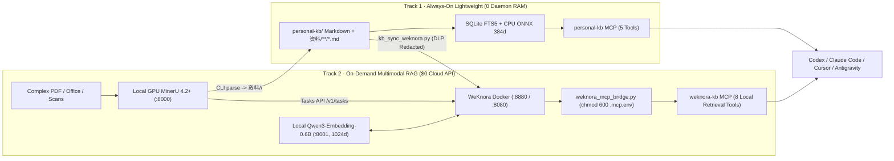

# Optional Track 2: Dual-Track Multimodal RAG (MinerU + Local Qwen3-Embedding + WeKnora)

[← Back to README](../README.md) · [返回中文首页](../README.zh-CN.md) · [Extension Scripts](../extensions/weknora-rag/)

> **Design Principle**: Keep Track 1 (`agent-memory-kb`) lightweight, zero-daemon, and sub-20ms for daily coding & multi-agent handoff. Mount **Track 2** on demand when dealing with complex PDFs, multi-table financial/technical reports, Word/PPT decks, or isolated temporary work documents — with **\$0 cloud embedding/parsing fees**.

---

## 1. Dual-Track Architecture（双轨并行架构）

| Dimension | Track 1: Always-On Lightweight (`personal-kb`) | Track 2: On-Demand Deep Multimodal RAG (`weknora-kb`) |
| --- | --- | --- |
| **Best For** | Daily coding, live Git probe, 5-source chat archive, mistake book, ~20ms lookups | Complex PDF/Word/PPT layout parsing (tables, formulas, scans), cross-document semantic RAG |
| **Runtime Footprint** | **0 background containers**, pure Python + SQLite | On-demand via `weknora-ctl start / stop` (~645MB 5-container Docker stack + local MPS models) |
| **Document Parsing** | Native Markdown + recursively indexed `资料/**/*.md` | Local GPU **MinerU 4.2+** (`mineru-api :8000`, Tasks API `/v1/tasks`) |
| **Embeddings & Search** | SQLite FTS5 (CJK unigram) + CPU INT8 ONNX (384d) | ParadeDB (`pgvector + BM25`) + Local **Qwen/Qwen3-Embedding-0.6B** (`:8001`, 1024d / 32K, **\$0**) |
| **4-Client MCP** | `personal-kb` (5 read-only atomic tools) | `weknora-kb` via `weknora_mcp_bridge.py` (8 zero-cost retrieval tools; graceful offline fallback) |



---

## 2. Physical Separation: Personal Vault vs. Temporary Work Documents（个人库与工作业务库物理分库）

A common failure mode of personal knowledge bases is dumping temporary, high-sensitivity work PDFs (commission plans, meeting transcripts, internal bids) into the same folder as long-term personal notes — polluting retrieval and risking accidental push to personal backups.

Recommended physical isolation:
- **`个人知识库`（Long-Term Personal Vault）**: Lives in `~/personal-kb`, synced via Track 1 encrypted disaster recovery and incrementally mirrored (after `kb_filters` DLP redaction) into WeKnora KB #1.
- **`工作业务库`（Temporary / High-Sensitivity Work Docs）**: Kept completely outside `~/personal-kb` (never enters personal Git/iCloud/GitHub backup), dragged directly into WeKnora Web UI KB #2 (bound to local MinerU + local Qwen3-Embedding) for clean, isolated MCP retrieval by KB name.

---

## 3. Zero-Cloud-Cost Setup (Scheme 1 — Recommended for Coding Agent Subscribers)

If you already subscribe to **Codex / Claude Code / Cursor / Antigravity** and do **not** want to pay separate OpenAI/Anthropic API bills for WeKnora:

1. **Parsing**: Run local MinerU 4.2+ (`mineru-api` on `:8000`, `MINERU_TELEMETRY_DISABLED=1`, protected by `chmod 600` `.mineru.env`).
2. **Embeddings**: Download open-weights `Qwen/Qwen3-Embedding-0.6B` (Apache-2.0, 1024d, 32K context) locally and serve it via [`local_embed_server.py`](../extensions/weknora-rag/scripts/local_embed_server.py) on `:8001` (Apple Silicon MPS `bfloat16` / CUDA / CPU, Bearer token in `chmod 600` `.embed.env`).
3. **WeKnora Docker**:
   - Use `WEKNORA_VERSION=main` (needed for MinerU 4.1+/4.2+ Tasks API `POST /v1/tasks`) and place [`docker-compose.override.yml`](../extensions/weknora-rag/docker-compose.override.yml) in the WeKnora directory to pin `docreader:latest`.
   - Set `SSRF_WHITELIST=host.docker.internal` in WeKnora `.env` so containers can call local `:8000` (MinerU) and `:8001` (Qwen3-Embedding).
4. **WeKnora MCP Endpoint**:
   - Create a built-in MCP endpoint in WeKnora Web UI (`http://localhost:8880`), enable only the **8 local retrieval tools** (`list_knowledge_bases`, `search_knowledge`, `grep_chunks`, `list_documents`, `read_document`, `wiki_search`, `wiki_read_page`, `wiki_index`), and disable `ask` + all write tools.
   - Let your AI client (Codex / Claude Code / Cursor / Antigravity) handle reasoning and synthesis using retrieved passages — **total extra API cost: \$0**.
   - Register [`weknora_mcp_bridge.py`](../extensions/weknora-rag/scripts/weknora_mcp_bridge.py) across all 4 clients so credentials stay solely in `chmod 600` `.mcp.env`, loopback calls bypass local HTTP proxies, and stopped Docker containers degrade gracefully without breaking client startup.

---

## 4. Battle-Tested Engineering Pitfalls Solved in These Scripts（实测踩坑与内置修复）

1. **WeKnora `:latest` vs. MinerU 4.2+ API mismatch (`POST /v1/uploads` 404)**: MinerU 4.1+ moved to Tasks API (`POST /v1/tasks`); use `WEKNORA_VERSION=main` + `docker-compose.override.yml`.
2. **Async Delete Race (`409 Duplicate`)**: WeKnora's `DELETE /api/v1/knowledge/:id` runs asynchronously. `kb_sync_weknora.py` polls `GET /api/v1/knowledge/:id` until `404` before uploading the updated Markdown, preventing race collisions.
3. **Summary LLM Failures on Zero-Credit APIs**: `kb_sync_weknora.py` passes `process_config={"summary_enabled": false}` by default so uploads never block on external chat APIs.
4. **Local Proxy Hijacking**: Both `weknora_mcp_bridge.py` and `kb_sync_weknora.py` bypass system HTTP proxies (`ProxyHandler({})`) for `localhost` / `127.0.0.1` / `host.docker.internal`.
5. **16GB RAM Hygiene**: Create a short symlink (`ln -sf ~/weknora-rag/scripts/weknora-ctl.sh ~/.local/bin/weknora-ctl`) to run `weknora-ctl start`, `weknora-ctl status`, `weknora-ctl sync`, and `weknora-ctl stop` on demand.

---

## 5. Quick Daily CLI Cheat Sheet

```bash
export WEKNORA_RAG_DIR="$HOME/weknora-rag"
export AGENT_MEMORY_KB_ROOT="$HOME/personal-kb"

# Optional shortcut symlink
ln -sf "$WEKNORA_RAG_DIR/scripts/weknora-ctl.sh" "$HOME/.local/bin/weknora-ctl"

# Daily commands
weknora-ctl start                                          # Start MinerU(:8000) + Qwen3(:8001) + WeKnora(:8880)
weknora-ctl status                                         # Full-stack health check
weknora-ctl parse report.pdf --category TechDocs           # Parse locally into ~/personal-kb/资料/TechDocs/ + refresh Track 1 index
weknora-ctl sync --dry-run                                 # Preview DLP-redacted incremental sync
weknora-ctl sync                                           # Sync curated notes & parsed docs to WeKnora
weknora-ctl stop                                           # Stop all Track 2 services & reclaim RAM
```
